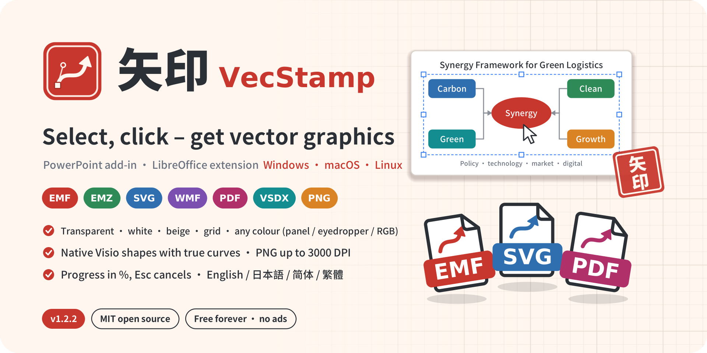
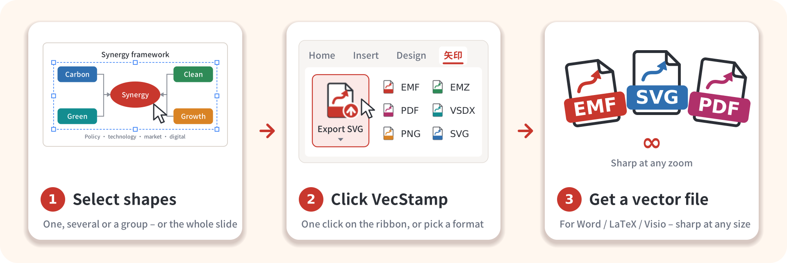
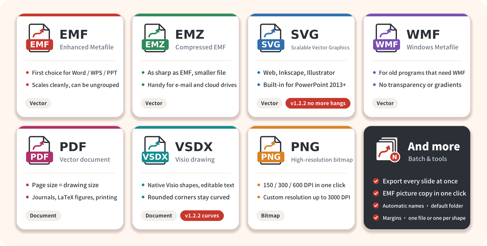
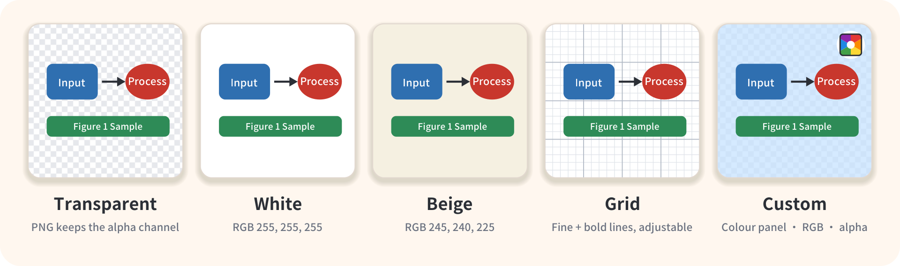
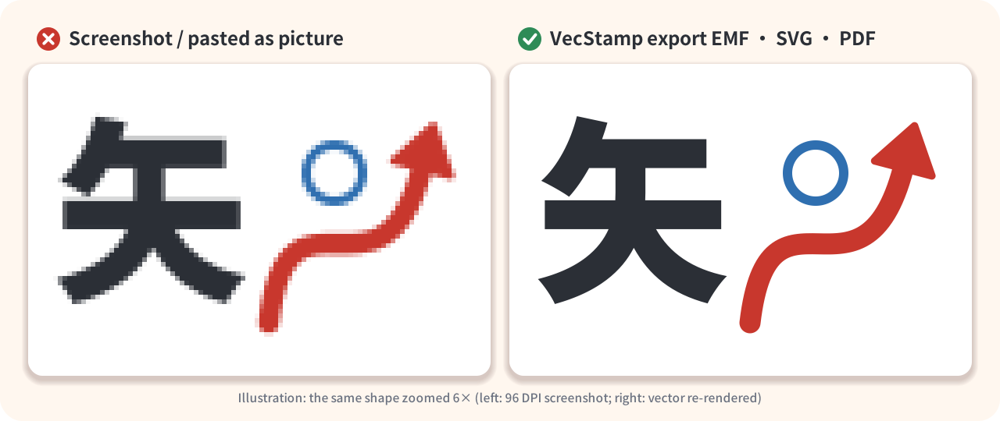
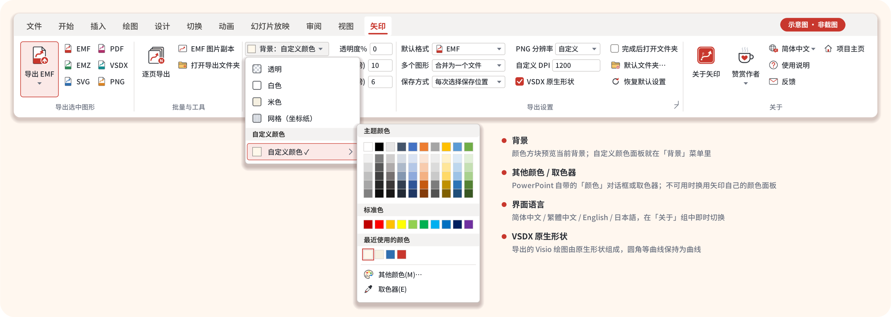
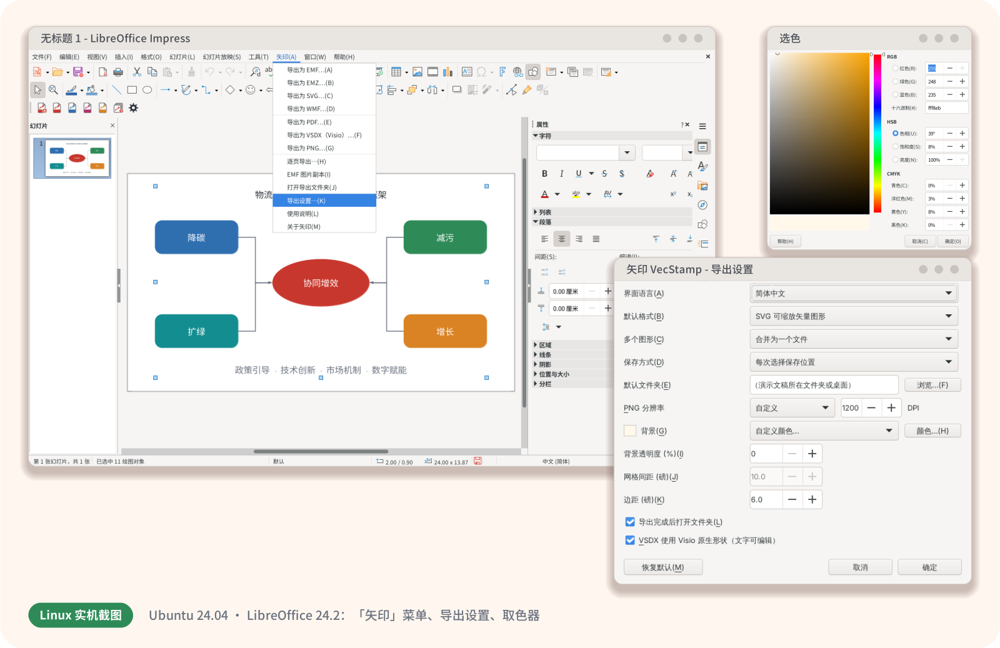
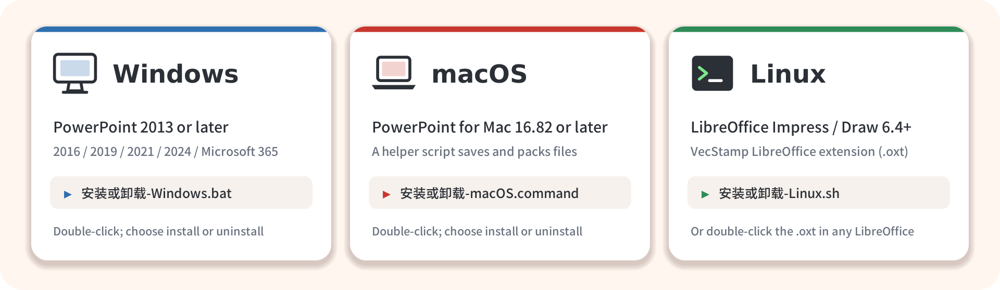

<p align="center">
  <a href="README.md">简体中文</a> | <a href="README.zh-TW.md">繁體中文</a> | <b>English</b> | <a href="README.ja.md">日本語</a>
</p>

<h1 align="center">VecStamp: export PowerPoint shapes to EMF, SVG, PDF and Visio in one click</h1>

<p align="center">
  
</p>

<p align="center">
  
  
  
  
  
  
  
</p>

<p align="center">
  <b>Select shapes on a slide, click once, get a vector graphic you can scale forever.</b><br>
  A free, open-source <b>PowerPoint add-in</b> (Windows / macOS) and <b>LibreOffice extension</b> (Linux) that exports diagrams, flowcharts
  and figures drawn in PowerPoint as EMF, EMZ, SVG, PDF, Visio VSDX, high-resolution PNG and WMF – made for <b>paper figures, proposals and technical documentation</b>.
</p>

<p align="center">
  <a href="https://vluckyzhang.cn/shiyin/en/">Website</a> ·
  <a href="#-whats-new-in-v122">What's new</a> ·
  <a href="#-seven-formats-pick-what-you-need">Formats</a> ·
  <a href="#-backgrounds-and-resolution">Backgrounds</a> ·
  <a href="#-installation">Install</a> ·
  <a href="#-faq">FAQ</a> ·
  <a href="#-support-the-project">Support</a> ·
  <a href="docs/DEVELOPMENT.md">Developer docs (Chinese)</a>
</p>

---

## 💡 Why VecStamp

The Chinese name **矢印** (*shǐ yìn*) reads "vector stamp": **矢** means both *vector* and *arrow*, **印** is a seal pressed onto paper. The logo is a vermilion seal holding a Bézier arrow with anchor points and handles – one press, and your figure is "stamped" out as a vector file.

Diagrams drawn in PowerPoint too often end up as blurry screenshots in Word or journal submissions, and PowerPoint's own *Save as Picture* handles one object at a time through several menus. VecStamp turns **"export PowerPoint as vector graphics"** into **one button**:

<p align="center"></p>

- **One-click export**: select one or more shapes (or nothing, to export the whole slide) and click Export; batch export of every slide is built in.
- **Seven formats**: EMF, EMZ, SVG, WMF, PDF, VSDX (Visio) and PNG (up to 3000 DPI).
- **Native Visio shapes**: VSDX files consist of editable Visio shapes; rounded corners and arcs stay true curves – **Visio is not needed**.
- **Backgrounds and margins**: transparent, white, beige, grid (graph paper) or any colour – and the background itself is vector, too.
- **Four interface languages**: Simplified Chinese (default), Traditional Chinese, English and Japanese, switchable at once.
- **Free, open source, offline**: MIT licence, no ads, no network access, no data collection.

## 🆕 What's new in v1.2.2

| | Change |
| --- | --- |
| 🐞 **SVG export no longer hangs** | Fixed SVG export staying at "converting to SVG" forever, with Esc unable to cancel: the converter now runs in the background, the progress window keeps updating and **Esc stops it at once**; a 180-second time limit offers Inkscape / LibreOffice or EMF instead; very large fonts are no longer embedded, which makes the conversion faster |
| ⭕ **Rounded shapes stay curved in VSDX** | A new DrawingML preset geometry engine computes **177 preset shapes** from the ECMA-376 formulas (rounded rectangles, round-corner arrows, clouds, waves, arcs, pies, …); arcs are written as Visio elliptical arcs, so rounded corners no longer turn into polygons; adjustment handles are honoured |
| 📊 **More detailed progress** | The progress window shows the **percentage**, the current file or slide (2 of 5), the current step (e.g. "Creating Visio shape 12 of 40: Rounded Rectangle 3", "converting element 350 of 1200") and the elapsed time – the same on Windows, macOS and LibreOffice, always cancellable |
| 🎨 **Colour panel inside the Background menu** | The separate *Background colour* button is now the **Custom colour** entry of the *Background* menu, and a **colour preview square** sits in front of "Background". When PowerPoint's *More Colors* dialog cannot be opened, VecStamp's own **colour panel** takes over (theme, standard and recent colours, RGB / hex input). macOS uses the system colour panel; LibreOffice falls back to the VecStamp panel when its colour picker is missing |
| 🌐 **Multilingual interface** | Ribbon, dialogs, progress window and messages in **Simplified Chinese, Traditional Chinese, English and Japanese** (default: Simplified Chinese); switch **instantly** in the language menu of the About group – no restart. In LibreOffice use *Export settings* or *VecStamp → Language* |
| 📝 **Multilingual docs and website** | README and website in four languages; the website adds hreflang, structured data and a sitemap so search engines find it more easily |

See [CHANGELOG.md](CHANGELOG.md) (Chinese) for the full history.

## 🧾 Seven formats, pick what you need

<p align="center"></p>

| You want to use the figure in… | Format | Notes |
| --- | --- | --- |
| Word / WPS papers and reports | **EMF** | Stays vector after inserting; double-click to ungroup and edit |
| E-mail, cloud drives | **EMZ** | EMF compressed with gzip: same content, smaller file; Office inserts it directly |
| Web, Inkscape, Illustrator, Figma | **SVG** | The universal vector format, opens in any browser; works with every PowerPoint 2013 or later |
| Journals, LaTeX, printing | **PDF** | Page size = drawing size, no white margins (PowerPoint pages are limited to 1–56 inches; larger drawings are scaled) |
| Further editing in Visio | **VSDX** | Native Visio shapes with editable text and smooth curves; Visio is not needed |
| Submission systems that only take bitmaps | **PNG** | 150 / 300 / 600 DPI or custom (up to 3000 DPI); transparent background supported |
| Old programs that only read old formats | **WMF** | No transparency or gradients; avoid unless needed |

## 🎨 Backgrounds and resolution

<p align="center"></p>

- **Transparent**: the default. PNG keeps the alpha channel; vector formats get no background at all.
- **White / beige**: beige is RGB 245, 240, 225 for a "paper" look.
- **Grid**: graph paper on white – fine lines RGB 222, 226, 232, every 5th line RGB 176, 184, 196; the **grid spacing** is adjustable in points (2–200).
- **Custom colour**: in *Background → Custom colour* pick a theme, standard or recent colour, or use *More Colors…* or the *Eyedropper*; or type `255,248,235`, `#FFF8EB` or `rgb(255,248,235)` into the RGB box; **transparency** 0–100 %. The colour square in front of "Background" always previews the current background – click it to open the colour panel.
- **Margin**: white space around the shapes (points), combinable with any background.
- **PNG resolution**: 150 / 300 / 600 DPI, or *Custom* with 1–3000 DPI. VecStamp asks before creating pictures of more than about 120 megapixels.

Backgrounds work with all seven formats; in vector formats the background is itself a vector rectangle and vector lines.

## 🔍 Why vector graphics

<p align="center"></p>

Screenshots get jagged and blurry when zoomed, printed or re-typeset by a journal. Vector graphics store the lines and the text themselves and render equally sharp at any size – usually in a smaller file, too.

## 🎛️ The ribbon (PowerPoint)

<p align="center"></p>
<p align="center"><sub>Illustration drawn from the actual layout in <code>src/customUI14.xml</code> (shown with the Chinese interface); the look differs slightly between Office versions.</sub></p>

| Group | Controls |
| --- | --- |
| Export selection | **Export EMF** (large button named after the default format; its menu lists every format under *Vector pictures / Documents / Bitmaps*) · EMF · EMZ · SVG · PDF · VSDX · PNG |
| Batch & tools | **Export every slide** (one file per slide, or only the selected slides) · EMF picture copy · Open export folder |
| Background | **Colour preview square + Background menu** (transparent / white / beige / grid / **Custom colour** → theme, standard and recent colours, More Colors…, Eyedropper) · RGB · Transparency % · Grid (pt) · Margin (pt) |
| Export settings | Default format · Several shapes (one file / one file per shape) · Saving (ask / save to default folder) · PNG resolution · Custom DPI · VSDX native shapes · Open folder when done · Default folder · Reset settings · current settings via the corner button |
| About | **About VecStamp** (version, author, MIT licence, free-forever promise) · **Support the author** (Alipay / WeChat Pay QR codes) · **Language** (简体中文 / 繁體中文 / English / 日本語) · Help · Feedback (e-mail / GitHub issue) · Project page |

## 🌐 Interface languages

Everything VecStamp shows – ribbon labels and tooltips, dialogs, the progress window, the colour panel and all messages – comes in four languages:

| Simplified Chinese (default) | Traditional Chinese | English | Japanese |
| --- | --- | --- | --- |
| 关于 → 简体中文 | 關於 → 繁體中文 | About → English | 矢印について → 日本語 |

- **PowerPoint**: choose the language in the language menu of the *About* group (it shows the current language, e.g. "简体中文"); the whole tab switches at once, no restart needed. The choice is stored for the current user and kept by *Reset settings*.
- **LibreOffice**: choose it in *VecStamp → Language…* or *Export settings → Language*; the next dialogs and messages use it at once. The VecStamp menu entries in the menu bar follow LibreOffice's own interface language (also available in these four languages).

## 🐧 Linux: LibreOffice extension

There is no PowerPoint for Linux, so on Linux VecStamp is a **LibreOffice Impress / Draw extension** with the same features as the PowerPoint add-in: seven formats, five backgrounds, custom DPI, slide-by-slide export, EMF picture copy, native Visio shapes and four interface languages.

<p align="center"></p>

After installing, a **VecStamp** menu and toolbar appear. *Export settings…* holds every option: the colour square in front of "Background" previews the background, and *Custom colour…* opens LibreOffice's colour picker (or the VecStamp colour panel when it is missing). Exports show a **progress window** with the current step and percentage (Esc or *Cancel* stops); *About* shows the donation QR codes, and *Feedback* offers e-mail or a GitHub issue. Settings are stored in `~/.config/VecStamp/libreoffice-settings.json`.

> The `.oxt` extension is platform-independent: LibreOffice users on Windows and macOS can install `dist/VecStamp-LibreOffice.oxt` with a double-click as well.

## 🖥️ Supported platforms

<p align="center"></p>

| | Windows | macOS (experimental) | Linux |
| --- | --- | --- | --- |
| Host | PowerPoint 2013 or later (2016 / 2019 / 2021 / 2024 / Microsoft 365 / LTSC) | PowerPoint for Mac **16.82** or later | LibreOffice **6.4** or later (Impress / Draw) with Python support |
| EMF / EMZ / WMF / PNG / PDF | ✅ | ✅ (as far as PowerPoint for Mac supports them) | ✅ |
| SVG | ✅ native from version 2302; **2013–2021 via the built-in XPS conversion** (Esc cancels, 180-second limit), then Inkscape / LibreOffice | ✅ native, Inkscape / LibreOffice as fallback | ✅ |
| VSDX | ✅ native Visio shapes (177 preset shapes stay curved, no Visio needed) | ✅ native Visio shapes (experimental) | ✅ native Visio shapes |
| Progress window | ✅ percentage + current step, Esc cancels | ✅ percentage + current step, *Cancel* button | ✅ percentage + current step, Esc / *Cancel* |
| Custom colour | ✅ PowerPoint's colour dialog, VecStamp colour panel as fallback | ✅ macOS colour panel, VecStamp colour list as fallback | ✅ LibreOffice colour picker, VecStamp colour panel as fallback |
| Interface languages | ✅ four, instant switching | ✅ four, instant switching | ✅ four, instant switching |
| Installer | `安装或卸载-Windows.bat` | `安装或卸载-macOS.command` | `安装或卸载-Linux.sh` |

WPS Presentation is not supported.

## 📦 Installation

> Download the [latest release](https://github.com/vluckyzhang/VecStamp/releases/latest) and **extract the whole folder** first (do not run the installers from inside the archive viewer). All installers change settings of the **current user** only and offer *Install / update* and *Uninstall* in a menu. The installer menus are in Chinese: **`1` = install / update, `2` = uninstall**, `3` = add a trusted location (Windows), `4` = only build `VecStamp.ppam` (Windows).

### Windows

1. Save and close all PowerPoint windows.
2. Double-click **`安装或卸载-Windows.bat`** ("install or uninstall") and enter `1`.
3. Open PowerPoint – the **矢印 / VecStamp** tab sits to the right of *View*. Switch the language in its *About* group.

If `dist` does not contain `VecStamp.ppam` yet, the installer builds it from source with your PowerPoint. This **temporarily** requires *Trust access to the VBA project object model* – the installer asks first, enables it only with your consent and restores the original setting right after.

What the installer does:

- copies `VecStamp.ppam` to `%APPDATA%\Microsoft\AddIns`;
- registers it for automatic loading under `HKCU\Software\Microsoft\Office\<version>\PowerPoint\AddIns\VecStamp`;
- adds **no** trusted location by default – only when you see macros disabled and choose `3`;
- menu `4` only builds `dist\VecStamp.ppam` without installing (for releases or for a Mac).

### macOS

1. Get `dist/VecStamp.ppam`: from a release, built on Windows with menu `4`, or built on the Mac as described in the [developer docs](docs/DEVELOPMENT.md).
2. Quit PowerPoint, double-click **`安装或卸载-macOS.command`** and enter `1`.
   If macOS says the developer cannot be verified, **right-click → Open** it in Finder, or run `bash 安装或卸载-macOS.command` in Terminal.
3. Enable it once in PowerPoint: *Tools → PowerPoint Add-ins… → + → VecStamp.ppam → OK*, and choose *Enable Macros* when asked.

The installer puts the add-in into the Office add-ins folder and installs the helper script `~/Library/Application Scripts/com.microsoft.Powerpoint/VecStamp.scpt`. PowerPoint for Mac runs VBA in a sandbox; save dialogs, writing files, EMZ / VSDX packing, the progress window, the colour panel and the SVG fallback go through this script. The installer does not change any system security setting.

### Linux

```bash
bash 安装或卸载-Linux.sh          # menu: 1 install / update, 2 uninstall
bash 安装或卸载-Linux.sh install  # or directly: install | uninstall | status
```

- Installs with `unopkg` in **user mode** – **no sudo** (running as root is refused).
- Finds the distribution's LibreOffice, the official build in `/opt`, Snap and Flatpak.
- If LibreOffice's Python support is missing it prints the command for your distribution, e.g. Debian / Ubuntu: `sudo apt install python3-uno libreoffice-script-provider-python`; Fedora: `sudo dnf install libreoffice-pyuno`.
- Without the script: LibreOffice *Tools → Extension Manager → Add* and choose `dist/VecStamp-LibreOffice.oxt`.

## 🗑️ Uninstalling

- **Windows**: close PowerPoint, run `安装或卸载-Windows.bat` and enter `2`. Removes the add-in file, the registry entries and any trusted location the installer added; optionally the export settings.
- **macOS**: quit PowerPoint, run `安装或卸载-macOS.command` and enter `2`; then select VecStamp in *Tools → PowerPoint Add-ins…* and click "−".
- **Linux**: close LibreOffice, run `安装或卸载-Linux.sh` and enter `2` (or `bash 安装或卸载-Linux.sh uninstall`); optionally removes the export settings.

## 🧩 SVG with every PowerPoint from 2013

Only **Microsoft 365 / Office 2024 version 2302 or later** (Mac 16.82 or later) can export SVG natively; Office 2013 / 2016 / 2019 / 2021 / LTSC may silently write some other XML through the same call – which is why such "SVG" files show *"This XML file does not appear to have any style information…"* in a browser. VecStamp works through these steps:

1. **Native export**: PowerPoint exports first, then the file is checked: the root element must be `<svg>` in the SVG namespace; missing `xmlns` / `xmlns:xlink` are added.
2. **Built-in XPS conversion** (Windows): when native export is not available, VecStamp puts the shapes on a temporary slide (master and background hidden), prints it to XPS with PowerPoint's own *Export as XPS*, and the built-in PowerShell script [`src/helpers/xps2svg.ps1`](src/helpers/xps2svg.ps1) turns the XPS into SVG:
   - paths, strokes (width, dashes, caps, joins), solid / linear / radial gradient and image fills, clipping and opacity become SVG elements;
   - text stays selectable, searchable `<text>`; the obfuscated font subsets in the XPS are restored and embedded with `@font-face` (fonts over 6 MB are referenced by name only);
   - only the drawing area is kept, no full-page margins;
   - since v1.2.2 the converter runs in the background: the progress window shows "reading the XPS → converting element n of N → embedding fonts → writing the SVG" with a percentage, **Esc stops it at once**, and after 180 seconds it stops and asks how to continue.
   The script is embedded in the add-in and runs locally with the Windows PowerShell that comes with Windows – no network, nothing to install.
3. **Inkscape / LibreOffice**: if that fails too, EMF is exported and converted with a local Inkscape or LibreOffice.
4. If everything fails, VecStamp offers EMF instead of leaving a broken file.

If an SVG still looks wrong, please send the file and your PowerPoint version (*File → Account → About PowerPoint*) to <vluckyzhang@gmail.com>.

## 📐 VSDX: native Visio shapes

VecStamp writes Visio 2013+ `.vsdx` files itself – **no Visio needed** – with native shapes:

| In PowerPoint | In Visio |
| --- | --- |
| Rectangles, rounded rectangles, ellipses, triangles, arrows, stars, callouts, flowchart shapes and other presets | Native shapes: geometry computed from the ECMA-376 preset formulas (177 shapes, adjustment handles included); **rounded corners and arcs are Visio elliptical arcs and stay true curves** |
| Lines, elbow and curved connectors | Native lines with width, dash style and arrowheads |
| Freeforms and polylines | Native shapes; Bézier curves become NURBS and stay smooth |
| Text in text boxes and shapes | Editable text with font, size, colour, bold / italic / underline, paragraph alignment and insets |
| Groups | Visio groups with the same hierarchy |
| Fill and line | Solid colours, transparency, gradients (approximated), line width and style; rotation and flips |
| Charts, SmartArt, pictures, tables, WordArt effects, … | Objects without a Visio equivalent stay in place as scalable **EMF vector pictures** |

To keep the whole drawing as one picture, clear **VSDX native shapes** in the export settings: the VSDX then embeds one EMF vector picture. The LibreOffice extension offers both modes as well.

## ✨ Tips

- With **nothing selected**, VecStamp offers to export every shape on the current slide (empty placeholders are skipped).
- Combined exports, backgrounds, margins and PDF briefly use the clipboard and a temporary slide at the end of the presentation (or an invisible temporary presentation), which are removed afterwards; the presentation's "saved" state does not change.
- Selecting shapes inside a group exports just those shapes.
- Placeholders (title boxes, …) cannot be grouped: combined exports then use an EMF picture automatically – still vector.
- With *One file per shape*, file names come from the shape names in the Selection Pane.
- Press **Esc** during an export (on macOS: *Cancel*) to stop; files already finished are kept and listed.
- Recently picked colours stay in *Recent colours* (up to 10).
- Every export command is also a public macro (`VS_ExportEMF`, `VS_ExportPDF`, `VS_ExportVSDX`, `VS_ExportSlides`, `VS_PickColor`, `VS_MoreColors`, `VS_Eyedropper`, `VS_Feedback`, …) that you can add to the Quick Access Toolbar.

## ❓ FAQ

<details>
<summary><b>There is no VecStamp tab in PowerPoint / macros are disabled</b></summary>

Check that VecStamp is ticked in *File → Options → Add-ins → Manage: PowerPoint Add-ins → Go*. If macros are disabled, run the Windows installer again and choose `3` to add the add-in folder as a trusted location (only that folder; removed again when uninstalling).
</details>

<details>
<summary><b>SVG export stays at "SVG via XPS"</b></summary>

That was a bug in 1.2.1 and is fixed in 1.2.2: the conversion runs in the background, the progress window shows the element being converted and the percentage, and Esc stops it immediately; after 180 seconds it stops and offers Inkscape / LibreOffice or EMF. Very complex drawings with a lot of text and pictures simply take longer.
</details>

<details>
<summary><b>Rounded rectangles became polygons in VSDX</b></summary>

Since 1.2.2, rounded rectangles and 176 other preset shapes are computed from the ECMA-376 formulas and their corners are written as Visio elliptical arcs. Make sure **VSDX native shapes** is ticked in the export settings (it is by default). If a shape still looks very different, please send the PPT file.
</details>

<details>
<summary><b>How do I switch to English?</b></summary>

PowerPoint: open the language menu in the *About* group at the right end of the 矢印 / VecStamp tab (it shows "简体中文") and choose *English*; the tab switches at once. LibreOffice: *VecStamp → Language…* (in a Chinese LibreOffice: *矢印 → 界面语言（Language）…*), then *English*.
</details>

<details>
<summary><b>A light-blue area behind pictures when LibreOffice opens the VSDX</b></summary>

That is how LibreOffice displays foreign objects (EMF pictures) in VSDX files; it is not in the file and does not appear in Visio.
</details>

<details>
<summary><b>How does Feedback work?</b></summary>

Choose *Yes* to e-mail the author: the address is copied to the clipboard so you can use any web mail, or open your default mail program. Choose *No* to open a new GitHub issue in your browser with the version and system information already filled in (needs a GitHub account; issues are public).
</details>

<details>
<summary><b>The fonts of an exported EMF change on another computer</b></summary>

EMF and SVG store font names; a computer without the font substitutes another one. Export **PDF** when the fonts must not change (fonts are embedded), or convert the text to outlines with Inkscape / Illustrator before submitting.
</details>

<details>
<summary><b>Why does a 3000 DPI PNG trigger a size warning?</b></summary>

The pixel count grows with the square of the DPI: a 10 × 6 inch figure at 3000 DPI has 540 million pixels. VecStamp asks before creating more than about 120 megapixels; 600–1200 DPI is usually plenty for papers – prefer a vector format when you need more.
</details>

<details>
<summary><b>The Linux installer says Python support is missing</b></summary>

Some distributions ship LibreOffice's Python support separately: install `python3-uno` and `libreoffice-script-provider-python` on Debian / Ubuntu / Deepin / UOS, `libreoffice-pyuno` on Fedora / openEuler / openSUSE. Arch and LibreOffice's official `.deb/.rpm`, Flatpak and Snap builds include it.
</details>

## 🧪 Test status

An honest account of what has been verified – feedback from other setups is very welcome:

| Part | How it is verified |
| --- | --- |
| LibreOffice extension (Linux) | Tested on Ubuntu 24.04 + LibreOffice 24.2: 7 formats × 5 backgrounds exported and checked, native VSDX re-imported and compared, progress callbacks and progress window (including cancel), every dialog in all four languages, `unopkg` install / uninstall; automated in `tests/test_libreoffice.py` |
| Linux installer | Install, update, status, uninstall and refusing root tested as a normal user |
| PowerPoint add-in (VBA) | VBA grammar parsing, static checks of all three conditional-compilation paths and ribbon XML schema validation; the 177 VSDX preset shapes are written to VSDX by a Python port, rendered by LibreOffice and compared with reference drawings (`tests/test_vsdx_presets.py`); the four string tables and the generated VBA code are checked entry by entry (`tests/test_i18n.py`); the XPS → SVG script is tested under PowerShell 7 for progress, time limit and a 4000-path stress sample. **v1.2.2 has not yet run in a real PowerPoint / Visio / Mac** (background conversion and Esc on Windows, colour panel, macOS progress dialog) – please report any problem |
| Windows / macOS installers | PowerShell parsing and shellcheck |
| Website | All four language pages screenshot-checked in Chromium at desktop and phone widths in light and dark mode; the zoom comparison and background preview are tested automatically |

## 🧱 Building from source

```bash
pip install cairosvg python-pptx pillow
python build/build.py            # icons → VBA module (with the four languages) → static checks → ribbon check → template → LibreOffice extension
python build/build.py --promo    # also redraw the README images and the four-language website
python3 tests/test_i18n.py         # interface languages: string tables and generated VBA code
python3 tests/test_vsdx_presets.py # VSDX preset shape geometry (needs LibreOffice and cairosvg)
python3 tests/test_libreoffice.py  # end-to-end test of the LibreOffice extension (Linux, as a normal user)
python3 tests/test_xps2svg.py      # XPS → SVG converter (needs PowerShell 7 / Windows PowerShell)
```

`VecStamp.ppam` has to be created by PowerPoint (Windows installer menu `4`, or import the module manually and save as an add-in). Project layout, build steps, translation workflow and the release checklist are in **[docs/DEVELOPMENT.md](docs/DEVELOPMENT.md)** (Chinese).

## 🌐 Website

[`website/`](website/) is a ready-to-deploy static website (no CDN or web fonts) in Simplified Chinese, Traditional Chinese, English and Japanese: a "screenshot vs vector" zoom comparison, an interactive background preview, installation guide, FAQ and donation QR codes, phone-friendly with dark mode, plus hreflang, canonical links, structured data (SoftwareApplication / FAQ) and a `sitemap.xml`. Edit the download link in `website/config.js` and upload it to any web server; see [website/README.md](website/README.md).

## ☕ Support the project

**VecStamp is and will stay free and open source**: MIT licence, no ads, no network access or data collection, no paid edition – every feature is for everyone.

If it saves you time, you are welcome to buy the author a coffee ☕ – entirely voluntary, nothing depends on it. A ⭐ on GitHub, a suggestion, or recommending VecStamp to colleagues helps a lot too.

<p align="center">
  
  &nbsp;&nbsp;&nbsp;&nbsp;
  
</p>
<p align="center"><sub>Left: Alipay · right: WeChat Pay. Both QR codes are also in <i>Support the author</i> and <i>About VecStamp</i> in the add-in.</sub></p>

## 📜 Licence and author

Released under the [MIT License](LICENSE) – free to use, modify and distribute.

Copyright (c) 2026 **vluckyzhang** · <vluckyzhang@gmail.com>

Questions and ideas are welcome by e-mail, through the *Feedback* button in the add-in (e-mail or GitHub issue) or as an [issue](https://github.com/vluckyzhang/VecStamp/issues). If VecStamp saved you some time, give the project a ⭐!

<sub>Keywords: export PowerPoint to SVG · PowerPoint to EMF · PPT to vector graphics · PowerPoint to Visio VSDX · save PowerPoint shapes as PDF · high-resolution PNG from PowerPoint · PowerPoint add-in · LibreOffice Impress extension · scientific figures · paper figures</sub>

<sub>Third-party notes: the VSDX preset shape geometry comes from presetShapeDefinitions.xml of the ECMA-376 standard; the defaults of the "No Style" style in the VSDX template follow the blank drawing shipped with the BSD-licensed vsdx package – see [THIRD_PARTY_NOTICES.md](THIRD_PARTY_NOTICES.md). Microsoft, PowerPoint, Visio and Windows are trademarks of Microsoft Corporation; macOS is a trademark of Apple Inc.; LibreOffice is a trademark of The Document Foundation; Alipay and WeChat are trademarks of their respective owners. This project is not affiliated with any of them.</sub>
