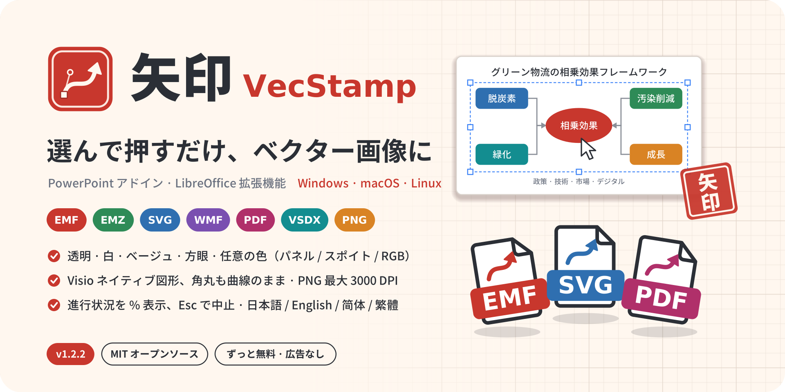
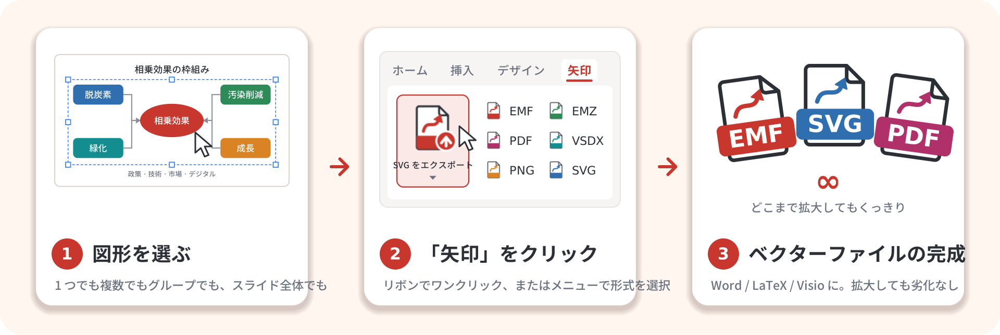
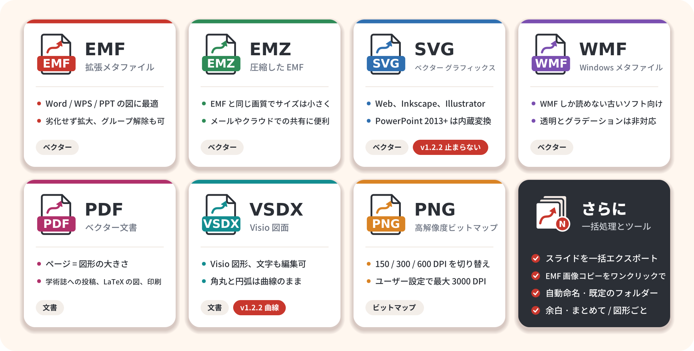
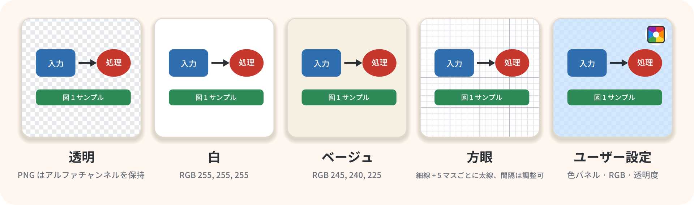
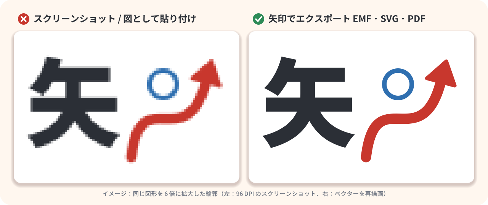
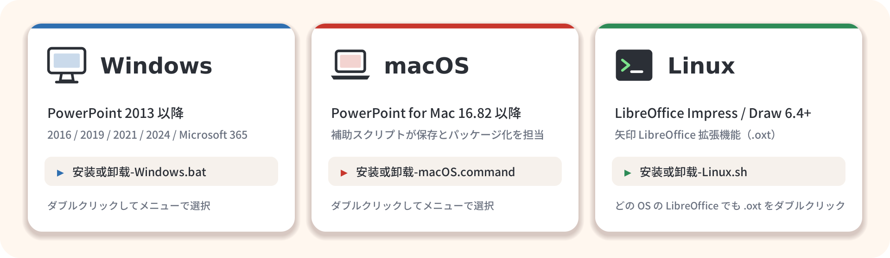

<p align="center">
  <a href="README.md">简体中文</a> | <a href="README.zh-TW.md">繁體中文</a> | <a href="README.en.md">English</a> | <b>日本語</b>
</p>

<h1 align="center">矢印 VecStamp：PowerPoint の図形を EMF / SVG / PDF / Visio にワンクリックでエクスポート</h1>

<p align="center">
  
</p>

<p align="center">
  
  
  
  
  
  
  
</p>

<p align="center">
  <b>スライドで図形を選んでクリックするだけ。いくら拡大しても粗くならないベクター画像ができあがります。</b><br>
  無料・オープンソースの <b>PowerPoint アドイン</b>（Windows / macOS）と <b>LibreOffice 拡張機能</b>（Linux）。PowerPoint で描いた構成図・フローチャート・模式図を
  EMF、EMZ、SVG、PDF、Visio VSDX、高解像度 PNG、WMF にワンクリックでエクスポートします。<b>論文の図、提案書、技術文書</b>のために作りました。
</p>

<p align="center">
  <a href="https://vluckyzhang.cn/shiyin/ja/">公式サイト</a> ·
  <a href="#-v122-の新機能">v1.2.2 の新機能</a> ·
  <a href="#-7-つの形式から用途に合わせて">形式</a> ·
  <a href="#-背景と解像度">背景</a> ·
  <a href="#-インストール">インストール</a> ·
  <a href="#-よくある質問">よくある質問</a> ·
  <a href="#-支援">支援</a> ·
  <a href="docs/DEVELOPMENT.md">開発ドキュメント（中国語）</a>
</p>

---

## 💡 「矢印」という名前

**矢**はベクター（中国語で「矢量」）であり矢印でもあります。**印**は判子のようにひと押しで「印す」こと。ロゴは朱色の印章に、アンカーポイントとハンドルの付いたベジェ曲線の矢印を収めたものです。

PowerPoint で描いた構成図やフローチャートを Word に貼って投稿すると、ぼやけたスクリーンショットになってしまいがちです。PowerPoint 標準の「図として保存」は一度に 1 つのオブジェクトしか扱えず、メニューも深い階層にあります。矢印は「**PowerPoint をベクター画像でエクスポート**」を**ボタン 1 つ**にしました。

<p align="center"></p>

- **ワンクリックでエクスポート**：図形を 1 つ以上選んで（何も選ばなければスライド全体）「エクスポート」をクリック。スライドごとの一括エクスポートも可能です。
- **7 つの形式**：EMF、EMZ、SVG、WMF、PDF、VSDX（Visio）、PNG（最大 3000 DPI）。
- **Visio のネイティブ図形**：VSDX は編集できる Visio 図形で構成され、角丸や円弧は本物の曲線のまま。**Visio は不要**です。
- **背景と余白**：透明・白・ベージュ・方眼（グラフ用紙）・任意の色。背景そのものもベクターです。
- **4 つの表示言語**：簡体字中国語（既定）、繁体字中国語、英語、日本語。すぐに切り替えられます。
- **ずっと無料・オープンソース・オフライン**：MIT ライセンス。広告なし、ネット接続なし、データ収集なし。

## 🆕 v1.2.2 の新機能

| | 内容 |
| --- | --- |
| 🐞 **SVG エクスポートが止まる問題を修正** | SVG のエクスポートが「SVG に変換」の段階で止まり、Esc でも中止できない問題を修正しました。変換プログラムはバックグラウンドで動き、進行状況ウィンドウは更新され続け、**Esc ですぐに停止**します。180 秒の制限時間を超えると Inkscape / LibreOffice または EMF への切り替えを提案します。非常に大きなフォントは埋め込まなくなり、変換も速くなりました |
| ⭕ **VSDX で角丸が曲線のまま** | 新しい DrawingML プリセット図形エンジンが ECMA-376 の数式から **177 種類のプリセット図形**（角丸四角形、角を丸めた矢印、雲、波、円弧、扇形など）を計算します。円弧は Visio の楕円弧として書き出すため、角丸が多角形になることはありません。調整ハンドルも反映されます |
| 📊 **より詳しい進行状況** | 進行状況ウィンドウに**パーセント**、現在のファイル／スライド（2 / 5）、現在の処理（例：「Visio 図形を作成しています 12 / 40：角丸四角形 3」「要素を変換しています 350 / 1200」）と経過時間を表示します。Windows・macOS・LibreOffice で共通、いつでも中止できます |
| 🎨 **背景メニューに色の選択パネル** | 「背景色」ボタンを「背景」メニューの「**ユーザー設定の色**」に統合し、「背景」の前に**色のプレビュー**を追加しました。PowerPoint の「その他の色」ダイアログを開けない場合は、矢印独自の**色パネル**（テーマの色・標準の色・最近使用した色・RGB / 16 進数入力）に切り替わります。macOS ではシステムのカラーパネル、LibreOffice ではカラーピッカーがない場合に矢印のパネルを使います |
| 🌐 **多言語インターフェース** | リボン、ダイアログ、進行状況ウィンドウ、メッセージが**簡体字中国語・繁体字中国語・英語・日本語**に対応（既定は簡体字中国語）。「矢印について」グループの言語メニューで**すぐに切り替え**られ、再起動は不要です。LibreOffice では「エクスポート設定」または「矢印 → 表示言語」で切り替えます |
| 📝 **多言語のドキュメントと公式サイト** | README と公式サイトを 4 言語で用意し、サイトには hreflang・構造化データ・サイトマップを追加して検索エンジンに見つけてもらいやすくしました |

すべての履歴は [CHANGELOG.md](CHANGELOG.md)（中国語）をご覧ください。

## 🧾 7 つの形式から用途に合わせて

<p align="center"></p>

| 図を使う場所 | おすすめ | 説明 |
| --- | --- | --- |
| Word / WPS の論文・レポート | **EMF** | 挿入後もベクターのまま。ダブルクリックでグループ解除して編集できます |
| メール、クラウドストレージ | **EMZ** | gzip で圧縮した EMF。内容は同じでサイズが小さく、Office にそのまま挿入できます |
| Web、Inkscape、Illustrator、Figma | **SVG** | 汎用のベクター形式で、ブラウザーで直接開けます。PowerPoint 2013 以降ならエクスポート可能 |
| 学術誌への投稿、LaTeX、印刷 | **PDF** | ページの大きさ = 図形の大きさ。余白なし（PowerPoint のページは 1～56 インチに制限され、超える場合は縮小） |
| Visio での編集 | **VSDX** | Visio のネイティブ図形で、文字は編集でき、曲線もなめらか。Visio は不要です |
| ビットマップしか受け付けない投稿システム | **PNG** | 150 / 300 / 600 DPI またはユーザー設定（最大 3000 DPI）。透明背景に対応 |
| 古い形式しか読めないソフト | **WMF** | 透明とグラデーションには非対応。必要なときだけ |

## 🎨 背景と解像度

<p align="center"></p>

- **透明**：既定値。PNG はアルファチャンネルを保持し、ベクター形式には下地を付けません。
- **白 / ベージュ**：ベージュは RGB 245, 240, 225。紙のような風合いになります。
- **方眼**：白地のグラフ用紙。細線 RGB 222, 226, 232、5 マスごとの太線 RGB 176, 184, 196。**方眼の間隔**は pt 単位で 2～200 に調整できます。
- **ユーザー設定の色**：「背景」メニューの「ユーザー設定の色」で、テーマの色・標準の色・最近使用した色を選ぶか、「その他の色…」「スポイト」を使います。RGB ボックスに `255,248,235`、`#FFF8EB`、`rgb(255,248,235)` を入力することもできます。**透明度**は 0～100 %。「背景」の前の色の四角は現在の背景を表示し、クリックすると色パネルが開きます。
- **余白**：図形の周りの余白（pt）。どの背景とも組み合わせられます。
- **PNG の解像度**：150 / 300 / 600 DPI をワンクリックで切り替えるか、「ユーザー設定」で 1～3000 DPI を入力します。約 1 億 2000 万ピクセルを超える場合は確認します。

背景は 7 つの形式すべてに適用され、ベクター形式では背景自体もベクターの四角形と線です。

## 🔍 なぜベクターなのか

<p align="center"></p>

スクリーンショットは拡大・印刷・学術誌での再組版でギザギザになったりぼやけたりします。ベクター画像は線と文字そのものを記録しているので、どの大きさでも同じようにくっきり描画でき、ファイルも小さくなりがちです。

## 🎛️ リボン（PowerPoint）

<p align="center"></p>
<p align="center"><sub><code>src/customUI14.xml</code> の実際のレイアウトをもとに描いたイメージ図です（中国語表示）。Office のバージョンによって見た目が少し異なります。</sub></p>

| グループ | コントロール |
| --- | --- |
| 選択範囲をエクスポート | **EMF をエクスポート**（大きなボタン。名前は既定の形式に合わせて変わり、メニューには全形式を「ベクター画像 / 文書 / ビットマップ」に分けて表示）· EMF · EMZ · SVG · PDF · VSDX · PNG |
| 一括処理とツール | **スライドごとにエクスポート**（1 枚 1 ファイル。選択したスライドだけも可）· EMF 画像コピー · エクスポート先を開く |
| 背景 | **色のプレビュー + 背景メニュー**（透明 / 白 / ベージュ / 方眼 / **ユーザー設定の色** → テーマの色・標準の色・最近使用した色・その他の色…・スポイト）· RGB · 透明度% · 方眼(pt) · 余白(pt) |
| エクスポート設定 | 既定の形式 · 複数の図形（まとめる / 図形ごと）· 保存方法（毎回選ぶ / 自動保存）· PNG 解像度 · ユーザー設定 DPI · VSDX ネイティブ図形 · 完了後にフォルダーを開く · 既定のフォルダー · 設定を既定に戻す · 右下で現在の設定を表示 |
| 矢印について | **矢印について**（バージョン、作者、MIT ライセンス、無料の約束）· **作者を支援**（Alipay / WeChat Pay の QR コード）· **表示言語**（简体中文 / 繁體中文 / English / 日本語）· 使い方 · フィードバック（メール / GitHub Issue）· プロジェクトページ |

## 🌐 表示言語

リボンのラベルとヒント、ダイアログ、進行状況ウィンドウ、色パネル、各種メッセージなど、矢印が表示するものはすべて 4 言語に対応しています。

| 簡体字中国語（既定） | 繁体字中国語 | 英語 | 日本語 |
| --- | --- | --- | --- |
| 关于 → 简体中文 | 關於 → 繁體中文 | About → English | 矢印について → 日本語 |

- **PowerPoint**：「矢印について」グループの言語メニュー（現在の言語、例：「简体中文」と表示）で選ぶと、タブ全体がすぐに切り替わります。再起動は不要です。選択は現在のユーザーの設定に保存され、「設定を既定に戻す」でも変わりません。
- **LibreOffice**：「矢印 → 表示言語（Language）…」または「エクスポート設定 → 表示言語」で選ぶと、以降のダイアログとメッセージにすぐ反映されます。メニューバーの矢印メニューの項目は LibreOffice 自体の表示言語に従います（同じ 4 言語に対応）。

## 🐧 Linux：LibreOffice 拡張機能

Microsoft PowerPoint には Linux 版がないため、Linux では **LibreOffice Impress / Draw の拡張機能**として提供しています。7 つの形式、5 種類の背景、ユーザー設定 DPI、スライドごとのエクスポート、EMF 画像コピー、Visio ネイティブ図形、4 つの表示言語と、PowerPoint 版と同じ機能を備えています。

<p align="center"></p>

インストールすると **矢印** メニューと **矢印** ツールバーが追加されます。「エクスポート設定…」ですべての項目を設定でき、「背景」の前の色の四角が背景をプレビューし、「ユーザー設定の色…」で LibreOffice のカラーピッカー（使えない場合は矢印の色パネル）が開きます。エクスポート中は**進行状況ウィンドウ**に現在の処理と割合が表示され、Esc または「キャンセル」で中止できます。「矢印について」には支援用の QR コードがあり、「フィードバック」はメールか GitHub Issue を選べます。設定は `~/.config/VecStamp/libreoffice-settings.json` に保存されます。

> この `.oxt` 拡張機能は OS に依存しません。Windows や macOS の LibreOffice でも `dist/VecStamp-LibreOffice.oxt` をダブルクリックしてインストールできます。

## 🖥️ 対応プラットフォーム

<p align="center"></p>

| | Windows | macOS（試験的） | Linux |
| --- | --- | --- | --- |
| ホストアプリ | PowerPoint 2013 以降（2016 / 2019 / 2021 / 2024 / Microsoft 365 / LTSC） | PowerPoint for Mac **16.82** 以降 | LibreOffice **6.4** 以降（Impress / Draw）、Python サポートが必要 |
| EMF / EMZ / WMF / PNG / PDF | ✅ | ✅（PowerPoint for Mac が対応する範囲） | ✅ |
| SVG | ✅ バージョン 2302 以降はネイティブ。**2013～2021 は内蔵の XPS 変換**（Esc で中止、180 秒で打ち切り）、失敗したら Inkscape / LibreOffice | ✅ ネイティブ、予備に Inkscape / LibreOffice | ✅ |
| VSDX | ✅ Visio ネイティブ図形（177 種類のプリセット図形は曲線のまま、Visio 不要） | ✅ Visio ネイティブ図形（試験的） | ✅ Visio ネイティブ図形 |
| 進行状況ウィンドウ | ✅ パーセント + 現在の処理、Esc で中止 | ✅ パーセント + 現在の処理、「キャンセル」ボタン | ✅ パーセント + 現在の処理、Esc /「キャンセル」 |
| ユーザー設定の色 | ✅ PowerPoint の色ダイアログ、使えない場合は矢印の色パネル | ✅ macOS のカラーパネル、使えない場合は矢印の色リスト | ✅ LibreOffice のカラーピッカー、使えない場合は矢印の色パネル |
| 表示言語 | ✅ 4 言語、すぐに切り替え | ✅ 4 言語、すぐに切り替え | ✅ 4 言語、すぐに切り替え |
| インストーラー | `安装或卸载-Windows.bat` | `安装或卸载-macOS.command` | `安装或卸载-Linux.sh` |

WPS Presentation には対応していません。

## 📦 インストール

> [最新版](https://github.com/vluckyzhang/VecStamp/releases/latest)をダウンロードしたら、まずフォルダー全体を**すべて展開**してください（圧縮ソフトの中から直接実行しないでください）。どのインストーラーも**現在のユーザー**の設定だけを変更し、メニューで「インストール / 更新」か「アンインストール」を選べます。インストーラーのメニューは中国語です：**`1` = インストール / 更新、`2` = アンインストール**、`3` = 信頼できる場所の追加（Windows）、`4` = `VecStamp.ppam` の作成のみ（Windows）。

### Windows

1. PowerPoint のウィンドウをすべて保存して閉じます。
2. **`安装或卸载-Windows.bat`**（「インストールまたはアンインストール」）をダブルクリックし、`1` を入力します。
3. PowerPoint を開くと、「表示」の右に **矢印** タブがあります。言語はタブの「矢印について」グループで切り替えます。

`dist` フォルダーに `VecStamp.ppam` がまだない場合、インストーラーはお使いの PowerPoint でソースから作成します。この処理では「VBA プロジェクト オブジェクト モデルへのアクセスを信頼する」を**一時的に**有効にする必要があります。インストーラーは先に確認し、同意を得た場合にだけ有効にして、作成後すぐに元の設定に戻します。

インストーラーが行うこと：

- `VecStamp.ppam` を `%APPDATA%\Microsoft\AddIns` にコピー
- `HKCU\Software\Microsoft\Office\<バージョン>\PowerPoint\AddIns\VecStamp` に自動読み込みとして登録
- 「信頼できる場所」は**既定では追加しません**。マクロが無効と表示され、メニューで `3` を選んだ場合だけ追加します
- メニュー `4` はインストールせずに `dist\VecStamp.ppam` を作成するだけです（配布や Mac 用）

### macOS

1. `dist/VecStamp.ppam` を用意します：リリースのファイル、Windows でメニュー `4` を使って作成したファイル、または[開発ドキュメント](docs/DEVELOPMENT.md)の手順で Mac 上で作成したもの。
2. PowerPoint を終了し、**`安装或卸载-macOS.command`** をダブルクリックして `1` を入力します。
   「開発元を検証できません」と表示された場合は、Finder で**右クリック → 開く**を選ぶか、ターミナルで `bash 安装或卸载-macOS.command` を実行してください。
3. PowerPoint で一度だけ有効にします：「ツール → PowerPoint アドイン… → + → VecStamp.ppam → OK」。確認が表示されたら「マクロを有効にする」を選びます。

インストーラーはアドインを Office のアドインフォルダーに置き、補助スクリプト `~/Library/Application Scripts/com.microsoft.Powerpoint/VecStamp.scpt` をインストールします。PowerPoint for Mac の VBA はサンドボックス内で動くため、保存ダイアログ、ファイルの書き込み、EMZ / VSDX のパッケージ化、進行状況ウィンドウ、色パネル、SVG の予備変換はこのスクリプトを通して行います。システムのセキュリティ設定は変更しません。

### Linux

```bash
bash 安装或卸载-Linux.sh          # メニュー：1 インストール / 更新、2 アンインストール
bash 安装或卸载-Linux.sh install  # 引数で直接指定も可：install | uninstall | status
```

- `unopkg` の**ユーザーモード**でインストールするため **sudo は不要**です（root での実行は拒否します）。
- ディストリビューションの LibreOffice、`/opt` の公式版、Snap 版、Flatpak 版を自動で探します。
- LibreOffice の Python サポートがない場合は、ディストリビューションに合わせたコマンドを表示します。例：Debian / Ubuntu は `sudo apt install python3-uno libreoffice-script-provider-python`、Fedora は `sudo dnf install libreoffice-pyuno`。
- スクリプトを使わずに、LibreOffice の「ツール → 拡張機能マネージャー → 追加」で `dist/VecStamp-LibreOffice.oxt` を選ぶこともできます。

## 🗑️ アンインストール

- **Windows**：PowerPoint を閉じて `安装或卸载-Windows.bat` を実行し、`2` を入力します。アドインのファイル、レジストリの登録、インストーラーが追加した信頼できる場所を削除し、エクスポート設定も選択して削除できます。
- **macOS**：PowerPoint を終了して `安装或卸载-macOS.command` を実行し、`2` を入力します。その後「ツール → PowerPoint アドイン…」で VecStamp を選んで「−」をクリックします。
- **Linux**：LibreOffice を閉じて `安装或卸载-Linux.sh` を実行し、`2` を入力します（または `bash 安装或卸载-Linux.sh uninstall`）。エクスポート設定も選択して削除できます。

## 🧩 SVG：PowerPoint 2013 以降ならどれでもエクスポート

SVG をネイティブにエクスポートできるのは **Microsoft 365 / Office 2024 のバージョン 2302 以降**（Mac は 16.82 以降）だけです。Office 2013 / 2016 / 2019 / 2021 / LTSC で同じ機能を呼び出すと、エラーを出さずに別の XML を書き出すことがあり、ブラウザーで *"This XML file does not appear to have any style information…"* と表示される原因になります。矢印は次の順に処理します。

1. **ネイティブのエクスポート**：まず PowerPoint にエクスポートさせ、ファイルを確認します。ルート要素は SVG 名前空間の `<svg>` でなければならず、足りない `xmlns` / `xmlns:xlink` は補います。
2. **内蔵の XPS 変換**（Windows）：ネイティブのエクスポートが使えない場合、図形だけを一時スライド（マスターと背景は非表示）に置き、PowerPoint 標準の「XPS としてエクスポート」でベクターのページに印刷してから、内蔵の PowerShell スクリプト [`src/helpers/xps2svg.ps1`](src/helpers/xps2svg.ps1) で XPS を SVG に変換します。
   - パス、線（線幅、破線、線端、結合）、単色 / 線形 / 放射グラデーションと画像の塗りつぶし、クリッピング、不透明度を SVG 要素として保持します。
   - 文字は選択・検索できる `<text>` のまま。XPS 内の難読化されたフォントサブセットを復元して `@font-face` で埋め込みます（6 MB を超えるフォントは名前だけ参照）。
   - 図形の範囲だけを切り出し、ページ全体の余白は残しません。
   - v1.2.2 から変換プログラムはバックグラウンドで動きます。進行状況ウィンドウに「XPS の読み込み → 要素の変換 n / N → フォントの埋め込み → SVG の書き出し」と割合を表示し、**Esc ですぐに停止**、180 秒を超えると停止して次の操作を確認します。
   スクリプトはアドインに組み込まれ、Windows 付属の Windows PowerShell でローカルに動きます。ネット接続もソフトのインストールも不要です。
3. **Inkscape / LibreOffice**：それでも失敗した場合は EMF をエクスポートし、ローカルの Inkscape または LibreOffice で変換します。
4. それでも失敗した場合は、開けないファイルを残すのではなく、EMF でのエクスポートを提案します。

それでも SVG がおかしい場合は、ファイルと PowerPoint のバージョン（「ファイル → アカウント → PowerPoint のバージョン情報」）を <vluckyzhang@gmail.com> までお送りください。

## 📐 VSDX：Visio のネイティブ図形

矢印は Visio 2013 以降の `.vsdx` を自分で作成します。**Visio は不要**で、図形はネイティブ図形として書き出されます。

| PowerPoint のオブジェクト | Visio での表現 |
| --- | --- |
| 四角形、角丸四角形、楕円、三角形、矢印、星、吹き出し、フローチャートなどのプリセット図形 | ネイティブ図形：形状は ECMA-376 のプリセット数式で計算（177 種類、調整ハンドルを含む）。**角丸と円弧は Visio の楕円弧になり、本物の曲線のまま** |
| 直線、カギ線 / 曲線コネクタ | ネイティブの線。線幅、破線、両端の矢印を保持 |
| フリーフォーム、多角形 | ネイティブ図形。ベジェ曲線は NURBS として書き出し、なめらかなまま |
| テキストボックスと図形内の文字 | そのまま編集できる文字。フォント、サイズ、色、太字 / 斜体 / 下線、段落の配置、内部余白を保持 |
| グループ | Visio のグループ。階層もそのまま |
| 塗りつぶしと線 | 単色、透明度、グラデーション（近似）、線幅、線種。回転と反転 |
| グラフ、SmartArt、画像、表、ワードアートの効果など | 対応する Visio 図形がないものは、拡大縮小できる **EMF ベクター画像**として元の位置に配置 |

図全体を 1 枚の画像にしたい場合は、エクスポート設定で **VSDX ネイティブ図形** のチェックを外すと、EMF ベクター画像を埋め込んだ VSDX になります。LibreOffice 拡張機能も両方の方法に対応しています。

## ✨ 使い方のヒント

- **何も選択していない**ときは、現在のスライドのすべての図形をエクスポートするか確認します（空のプレースホルダーはスキップ）。
- まとめてのエクスポート、背景や余白の追加、PDF のエクスポートでは、クリップボードとプレゼンテーション末尾の一時スライド（または非表示の一時プレゼンテーション）を一時的に使い、完了後に自動で削除します。ファイルの「保存済み」状態は変わりません。
- グループ内の一部の図形を選択すると、その図形だけをエクスポートします。
- プレースホルダー（タイトル枠など）はグループ化できないため、まとめてエクスポートするときは自動で EMF 画像を使います（ベクターのまま）。
- 「複数の図形」を「図形ごとに 1 ファイル」にすると、ファイル名は「選択ウィンドウ」の図形名になります。
- エクスポート中に **Esc**（macOS では「キャンセル」）を押すと中止でき、完了したファイルは残して一覧表示します。
- 色パネルで最近選んだ色は「最近使用した色」に残ります（最大 10 色）。
- すべてのエクスポートコマンドは公開マクロ（`VS_ExportEMF`、`VS_ExportPDF`、`VS_ExportVSDX`、`VS_ExportSlides`、`VS_PickColor`、`VS_MoreColors`、`VS_Eyedropper`、`VS_Feedback` など）でもあり、クイックアクセスツールバーに追加できます。

## ❓ よくある質問

<details>
<summary><b>PowerPoint に「矢印」タブが表示されない / マクロが無効になっている</b></summary>

「ファイル → オプション → アドイン → 管理：PowerPoint アドイン → 設定」で VecStamp にチェックが入っているか確認してください。マクロが無効と表示される場合は、Windows インストーラーをもう一度実行して `3` を選び、アドインのフォルダーを信頼できる場所に追加します（そのフォルダーだけが対象で、アンインストール時に削除されます）。
</details>

<details>
<summary><b>SVG のエクスポートが「XPS 経由で SVG を作成」で止まる</b></summary>

1.2.1 の不具合で、1.2.2 で修正しました。変換はバックグラウンドで動き、進行状況ウィンドウに変換中の要素と割合が表示され、Esc ですぐに停止できます。180 秒を超えると停止し、Inkscape / LibreOffice または EMF を提案します。文字や画像の多い複雑な図形は時間がかかりますが、正常な動作です。
</details>

<details>
<summary><b>VSDX で角丸四角形が多角形になる</b></summary>

1.2.2 から、角丸四角形を含む 177 種類のプリセット図形を ECMA-376 の数式で計算し、角を Visio の楕円弧として書き出すようになりました。エクスポート設定で **VSDX ネイティブ図形** にチェックが入っているか確認してください（既定でオン）。それでも元の図形と大きく違う場合は、PPT ファイルを添えてご連絡ください。
</details>

<details>
<summary><b>日本語表示に切り替えるには？</b></summary>

PowerPoint：「矢印」タブの右端にある「关于」（矢印について）グループの言語メニュー（「简体中文」と表示）を開き、「日本語」を選ぶと、タブがすぐに切り替わります。LibreOffice：メニュー「矢印 → 表示言語（Language）…」（中国語版の LibreOffice では「矢印 → 界面语言（Language）…」）で「日本語」を選びます。
</details>

<details>
<summary><b>LibreOffice で VSDX を開くと画像の後ろに水色の領域が表示される</b></summary>

LibreOffice が VSDX 内の外部オブジェクト（EMF 画像）を表示するときの仕様で、ファイルの内容とは関係ありません。Visio では表示されません。
</details>

<details>
<summary><b>「フィードバック」の送り方は？</b></summary>

表示されるウィンドウで「はい」を選ぶとメールで送れます。作者のメールアドレスがクリップボードにコピーされるので、任意の Web メールから送信するか、既定のメールソフトを開けます。「いいえ」を選ぶと、バージョンとシステム情報を記入済みの GitHub の新規 Issue ページがブラウザーで開きます（GitHub アカウントが必要で、内容は公開されます）。
</details>

<details>
<summary><b>エクスポートした EMF のフォントが他のパソコンで変わる</b></summary>

EMF と SVG はフォント名を記録しているため、相手のパソコンにそのフォントがないと別のフォントに置き換えられます。フォントを固定したい場合は **PDF**（フォントを埋め込み）でエクスポートするか、投稿前に Inkscape / Illustrator で文字をアウトライン化してください。
</details>

<details>
<summary><b>3000 DPI の PNG でファイルが大きすぎると警告されるのはなぜ？</b></summary>

ピクセル数は DPI の 2 乗で増えます。10 × 6 インチの図は 3000 DPI で 5 億 4000 万ピクセルになります。約 1 億 2000 万ピクセルを超える場合は確認を求めます。論文の図なら通常 600～1200 DPI で十分で、さらに高精細が必要ならベクター形式をおすすめします。
</details>

<details>
<summary><b>Linux のインストールで Python サポートがないと表示される</b></summary>

一部のディストリビューションでは LibreOffice の Python サポートが別パッケージです。Debian / Ubuntu / Deepin / UOS は `python3-uno` と `libreoffice-script-provider-python`、Fedora / openEuler / openSUSE は `libreoffice-pyuno` をインストールしてください。Arch と LibreOffice 公式の `.deb/.rpm`、Flatpak、Snap 版には含まれています。
</details>

## 🧪 テスト状況

現時点で確認できている範囲を正直に記載します。他の環境でのお試しとフィードバックを歓迎します。

| 部分 | 確認方法 |
| --- | --- |
| LibreOffice 拡張機能（Linux） | Ubuntu 24.04 + LibreOffice 24.2 で実機テスト：7 形式 × 5 背景をすべてエクスポートしてファイルを検証、ネイティブ VSDX を再読み込みして比較、進行状況のコールバックとウィンドウ（中止を含む）、4 言語すべてのダイアログ、`unopkg` によるインストール / アンインストール。自動テストは `tests/test_libreoffice.py` |
| Linux インストーラー | 一般ユーザーでのインストール、更新、状態確認、アンインストール、root の拒否を実機で確認 |
| PowerPoint アドイン（VBA） | VBA の構文解析、3 つの条件付きコンパイル経路の静的チェック、リボン XML のスキーマ検証。177 種類の VSDX プリセット図形は Python 移植版で VSDX に書き出し、LibreOffice で描画して参照図と比較（`tests/test_vsdx_presets.py`）。4 言語の文字列表と生成された VBA コードを 1 件ずつ照合（`tests/test_i18n.py`）。XPS → SVG 変換スクリプトは PowerShell 7 で進行状況、制限時間、4000 パスの負荷サンプルを検証。**v1.2.2 は実際の PowerPoint / Visio / Mac ではまだ動作確認していません**（Windows のバックグラウンド変換と Esc、色パネル、macOS の進行状況ダイアログなど）。問題があればお知らせください |
| Windows / macOS インストーラー | PowerShell の構文解析と shellcheck |
| 公式サイト | 4 言語のページを Chromium でデスクトップ / スマートフォン幅、ライト / ダークモードのスクリーンショットで確認。拡大比較と背景プレビューの操作を自動テスト |

## 🧱 ソースからのビルド

```bash
pip install cairosvg python-pptx pillow
python build/build.py            # アイコン → VBA モジュール（4 言語の文字列を含む）→ 静的チェック → リボンのチェック → テンプレート → LibreOffice 拡張機能
python build/build.py --promo    # README の画像と 4 言語の公式サイトも作り直す
python3 tests/test_i18n.py         # 表示言語：文字列表と生成された VBA コード
python3 tests/test_vsdx_presets.py # VSDX プリセット図形の形状（LibreOffice と cairosvg が必要）
python3 tests/test_libreoffice.py  # LibreOffice 拡張機能のエンドツーエンドテスト（Linux、一般ユーザーで実行）
python3 tests/test_xps2svg.py      # XPS → SVG 変換スクリプト（PowerShell 7 / Windows PowerShell が必要）
```

`VecStamp.ppam` は PowerPoint で作成する必要があります（Windows インストーラーのメニュー `4`、または手動でモジュールをインポートしてアドインとして保存）。プロジェクト構成、ビルド手順、翻訳の方法、リリース手順は **[docs/DEVELOPMENT.md](docs/DEVELOPMENT.md)**（中国語）にあります。

## 🌐 公式サイト

[`website/`](website/) はそのまま公開できる静的な公式サイトです（CDN や Web フォントに依存しません）。簡体字中国語・繁体字中国語・英語・日本語の 4 言語版があり、「スクリーンショット vs ベクター」の拡大比較、背景プレビュー、インストール手順、よくある質問、支援用 QR コードを収め、スマートフォンとダークモードに対応しています。hreflang、canonical、構造化データ（SoftwareApplication / FAQ）、`sitemap.xml` も備えています。`website/config.js` のダウンロード先を変更して任意の Web サーバーにアップロードしてください。手順は [website/README.md](website/README.md)（中国語）をご覧ください。

## ☕ 支援

**矢印はずっとオープンソース・無料です**：MIT ライセンスで公開し、広告もネット接続もデータ収集もなく、有料版も出しません。すべての機能を誰でも使えます。

時間の節約になったら、QR コードから作者にコーヒーをごちそうしていただけるとうれしいです ☕ —— 支援は任意で、機能には一切影響しません。GitHub での ⭐、提案、必要な方への紹介も大きな励みになります。

<p align="center">
  
  &nbsp;&nbsp;&nbsp;&nbsp;
  
</p>
<p align="center"><sub>左：Alipay（支付宝）· 右：WeChat Pay（微信支付）。アドインの「作者を支援」と「矢印について」にも同じ QR コードがあります。</sub></p>

## 📜 ライセンスと作者

[MIT License](LICENSE) で公開しています。自由に使用、改変、再配布できます。

Copyright (c) 2026 **vluckyzhang** · <vluckyzhang@gmail.com>

質問や提案は、メール、アドインの「フィードバック」ボタン（メールまたは GitHub Issue）、[Issue](https://github.com/vluckyzhang/VecStamp/issues) からお寄せください。矢印が少しでも役に立ったら、プロジェクトに ⭐ をお願いします！

<sub>キーワード：PowerPoint SVG エクスポート · PowerPoint EMF 保存 · パワポ ベクター画像 · PowerPoint から Visio VSDX · PowerPoint 図形 PDF 保存 · 高解像度 PNG · PowerPoint アドイン · LibreOffice Impress 拡張機能 · 論文 図 作成 · 研究 図表</sub>

<sub>第三者に関する表示：VSDX のプリセット図形の形状は ECMA-376 規格の presetShapeDefinitions.xml に基づきます。VSDX テンプレートの「No Style」スタイルの既定値は、BSD ライセンスの vsdx パッケージに付属する空の図面を参考にしています。詳しくは [THIRD_PARTY_NOTICES.md](THIRD_PARTY_NOTICES.md) をご覧ください。Microsoft、PowerPoint、Visio、Windows は Microsoft Corporation の商標です。macOS は Apple Inc. の商標です。LibreOffice は The Document Foundation の商標です。Alipay（支付宝）、WeChat（微信）はそれぞれの所有者の商標です。本プロジェクトはこれらの企業と提携関係にありません。</sub>
