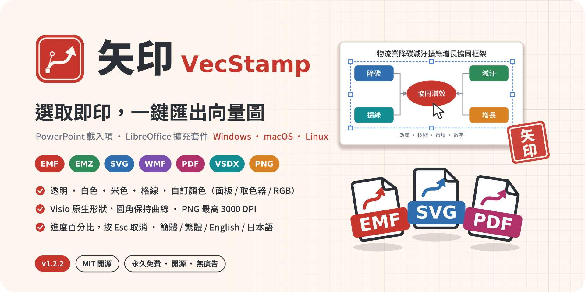
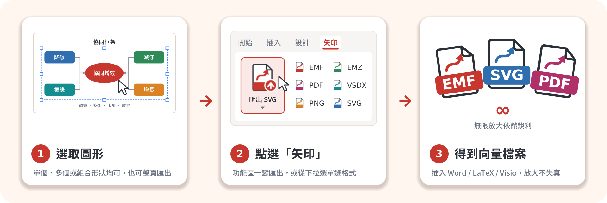
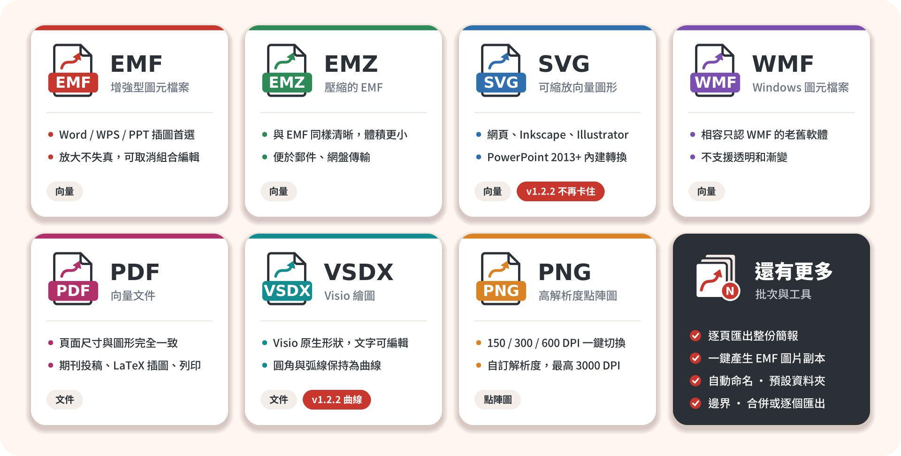
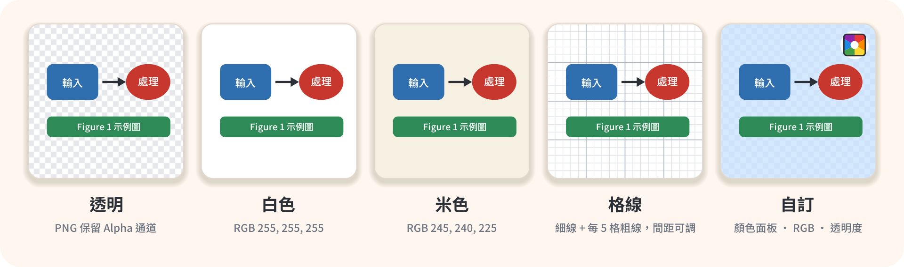
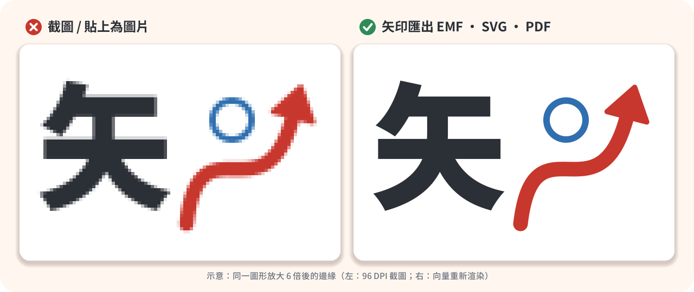
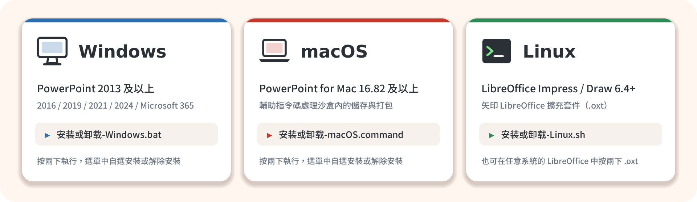

<p align="center">
  <a href="README.md">简体中文</a> | <b>繁體中文</b> | <a href="README.en.md">English</a> | <a href="README.ja.md">日本語</a>
</p>

<h1 align="center">矢印 VecStamp：PowerPoint 圖形一鍵匯出 EMF / SVG / PDF / Visio 向量圖</h1>

<p align="center">
  
</p>

<p align="center">
  
  
  
  
  
  
  
</p>

<p align="center">
  <b>在投影片裡選取圖形，點一下，得到能無限放大的向量圖。</b><br>
  免費開源的 <b>PowerPoint 載入項</b>（Windows / macOS）和 <b>LibreOffice 擴充套件</b>（Linux）：把 PPT 裡畫的框架圖、流程圖、示意圖一鍵匯出為
  EMF、EMZ、SVG、PDF、Visio VSDX、高解析度 PNG 和 WMF，適合<b>論文插圖、標書配圖、技術文件</b>。
</p>

<p align="center">
  <a href="https://vluckyzhang.cn/shiyin/zh-TW/">軟體官網</a> ·
  <a href="#-v122-新功能">v1.2.2 新功能</a> ·
  <a href="#-七種格式按需而選">格式</a> ·
  <a href="#-背景與解析度">背景</a> ·
  <a href="#-安裝">安裝</a> ·
  <a href="#-常見問題">常見問題</a> ·
  <a href="#-贊助支援">贊助</a> ·
  <a href="docs/DEVELOPMENT.md">開發文件</a>
</p>

---

## 💡 為什麼是「矢印」

**矢**是向量，也是箭頭；**印**是一按即成，像蓋章一樣把圖「印」出來。Logo 是一枚硃紅印章，裡面是一條帶錨點和控制柄的貝塞爾曲線箭頭。

在 PowerPoint 裡畫好的框架圖、技術路線圖、流程圖，放進 Word 投稿時最怕變成一張模糊的截圖；PowerPoint 自帶的「另存為圖片」一次只能處理一個物件，還要逐層點選單。矢印把「**PPT 匯出向量圖**」變成**一個按鈕**：

<p align="center"></p>

- **一鍵匯出**：選取一個或多個圖形（或什麼都不選，匯出整頁），點「匯出」即可；支援逐頁批次匯出。
- **七種格式**：EMF、EMZ、SVG、WMF、PDF、VSDX（Visio）、PNG（最高 3000 DPI）。
- **Visio 原生形狀**：匯出的 VSDX 由可編輯的 Visio 形狀組成，圓角、弧線保持為真正的曲線，**無需安裝 Visio**。
- **背景與邊界**：透明、白色、米色、格線（座標紙）或任意顏色，背景本身也是向量。
- **四種介面語言**：簡體中文（預設）、繁體中文、English、日本語，即時切換。
- **永久免費、開源、離線**：MIT 授權，沒有廣告，不聯網、不收集任何資料。

## 🆕 v1.2.2 新功能

| | 更新內容 |
| --- | --- |
| 🐞 **修復 SVG 匯出卡住** | 修復匯出 SVG 時一直停在「轉換為 SVG」階段、按 Esc 也無法取消的問題：轉換程式改為背景執行，進度視窗持續重新整理，**按 Esc 立即終止**；轉換設有超時（180 秒），超時後可改用 Inkscape / LibreOffice 或匯出 EMF；超大字型不再嵌入，轉換更快 |
| ⭕ **VSDX 圓角保持為曲線** | 全新的 DrawingML 預設形狀引擎按 ECMA-376 標準公式計算 **177 種預設形狀**（圓角矩形、對角圓角矩形、圓角箭頭、雲形、波浪、弧形、餅形……），弧線寫成 Visio 橢圓弧，圓角不再變成多邊形；調整控點同樣生效 |
| 📊 **更詳細的匯出進度** | 進度視窗顯示**百分比**、目前檔案 / 投影片（第 2 / 5 個）、目前步驟（如「產生 Visio 形狀 12 / 40：圓角矩形 3」「轉換圖形元素 350 / 1200」）和已用時間；Windows、macOS、LibreOffice 三端一致，均可取消 |
| 🎨 **背景選單內建取色面板** | 「背景顏色」按鈕併入「背景」下拉選單的「**自訂顏色**」選項，「背景」文字前新增**顏色預覽方塊**；PowerPoint 的「其他顏色」對話方塊不可用時，自動換用矢印自帶的**顏色面板**（主題色、標準色、最近使用的顏色、RGB / 十六進位輸入）。macOS 使用系統顏色面板，LibreOffice 在取色器不可用時同樣換用矢印面板 |
| 🌐 **多語言介面** | 功能區、對話方塊、進度視窗和提示資訊支援**簡體中文、繁體中文、English、日本語**，預設簡體中文；在「關於」組的語言選單中**即時切換**，無需重新啟動。LibreOffice 擴充套件在「匯出設定」或「矢印 → 介面語言」中切換 |
| 📝 **多語言文件與官網** | README 與宣傳網站提供四種語言版本，網站加入 hreflang、結構化資料和 sitemap，更容易被搜尋引擎收錄 |

完整記錄見 [CHANGELOG.md](CHANGELOG.md)。

## 🧾 七種格式，按需而選

<p align="center"></p>

| 你要把圖用在… | 推薦格式 | 說明 |
| --- | --- | --- |
| Word / WPS 論文、報告 | **EMF** | 插入後保持向量，按兩下可取消組合再編輯 |
| 郵件、網盤傳送 | **EMZ** | gzip 壓縮的 EMF，內容相同、體積更小，Office 可直接插入 |
| 網頁、Inkscape、Illustrator、Figma | **SVG** | 通用向量格式，瀏覽器可直接開啟；PowerPoint 2013 起均可匯出 |
| 期刊投稿、LaTeX、列印 | **PDF** | 頁面大小 = 圖形大小，不留白邊（PowerPoint 頁面限制為 1 – 56 英寸，超出時等比縮放） |
| 交給 Visio 繼續編輯 | **VSDX** | 由 Visio 原生形狀組成，文字可編輯，曲線保持平滑；不需要安裝 Visio |
| 只接受點陣圖的投稿系統 | **PNG** | 150 / 300 / 600 DPI 或自訂（最高 3000 DPI）；支援透明背景 |
| 只認舊格式的老軟體 | **WMF** | 不支援透明和漸變，非必要不選 |

## 🎨 背景與解析度

<p align="center"></p>

- **透明**：預設值。PNG 保留 Alpha 通道，向量格式不加任何底色。
- **白色 / 米色**：米色為 RGB 245, 240, 225，適合做出「紙張感」的插圖。
- **格線**：白底上的方格紙，細線 RGB 222, 226, 232，每 5 格一條粗線 RGB 176, 184, 196；**格線間距**以磅為單位可調（2 – 200）。
- **自訂顏色**：在「背景」選單的「自訂顏色」中選擇主題顏色、標準色、最近使用的顏色，或用「其他顏色…」「取色器」；也可以在 RGB 框中輸入 `255,248,235`、`#FFF8EB`、`rgb(255,248,235)`；**透明度** 0 – 100 % 可調。「背景」前的顏色方塊隨時顯示目前背景，點一下即可開啟顏色面板。
- **邊界**：圖形四周留白（磅），與任何背景都能組合。
- **PNG 解析度**：150 / 300 / 600 DPI 一鍵切換，或選「自訂」輸入 1 – 3000 DPI。超過約 1.2 億畫素時會先提醒你確認。

背景作用於全部七種格式：向量格式中的背景本身也是向量矩形和線條。

## 🔍 為什麼一定要向量

<p align="center"></p>

截圖在放大、列印或被期刊重新排版時會出現鋸齒和模糊；向量圖記錄的是線條和文字本身，任何尺寸都能重新渲染得一樣清晰，檔案往往還更小。

## 🎛️ 功能區一覽（PowerPoint）

<p align="center"></p>
<p align="center"><sub>示意圖，按 <code>src/customUI14.xml</code> 中的實際佈局繪製；不同 Office 版本的外觀略有差異。</sub></p>

| 分組 | 控制元件 |
| --- | --- |
| 匯出選取圖形 | **匯出 EMF**（大按鈕，名稱隨預設格式變化；下拉選單分「向量圖 / 文件 / 點陣圖」列出全部格式）· EMF · EMZ · SVG · PDF · VSDX · PNG |
| 批次與工具 | **逐頁匯出**（每頁一個檔案，可只匯出多選的頁面）· EMF 圖片副本 · 開啟匯出資料夾 |
| 背景 | **顏色預覽方塊 + 背景選單**（透明 / 白色 / 米色 / 格線 / **自訂顏色** → 主題顏色、標準色、最近使用的顏色、其他顏色…、取色器）· RGB · 透明度% · 格線(磅) · 邊界(磅) |
| 匯出設定 | 預設格式 · 多個圖形（合併 / 逐個）· 儲存方式（每次詢問 / 自動儲存）· PNG 解析度 · 自訂 DPI · VSDX 原生形狀 · 完成後開啟資料夾 · 預設資料夾 · 恢復預設設定 · 右下角檢視目前全部設定 |
| 關於 | **關於矢印**（版本、作者、MIT 授權、永久免費宣告）· **贊助作者**（支付寶 / 微信QR Code）· **介面語言**（簡體中文 / 繁體中文 / English / 日本語）· 使用說明 · 意見回饋（郵件 / GitHub Issue）· 專案首頁 |

## 🌐 介面語言

矢印的全部介面 —— 功能區標籤與提示、對話方塊、進度視窗、顏色面板和各種提示資訊 —— 都有四種語言：

| 簡體中文（預設） | 繁體中文 | English | 日本語 |
| --- | --- | --- | --- |
| 關於 → 簡體中文 | 關於 → 繁體中文 | About → English | 矢印について → 日本語 |

- **PowerPoint**：在「關於」組的語言選單中選擇，整個選項卡立即重新整理，無需重新啟動。設定儲存在目前使用者的配置中，「恢復預設設定」不會改變語言。
- **LibreOffice**：在「矢印 → 介面語言（Language）…」或「匯出設定 → 介面語言」中選擇，之後開啟的對話方塊和提示立即使用新語言；選單欄中的矢印選單項跟隨 LibreOffice 自身的介面語言（同樣提供這四種語言）。

## 🐧 Linux：LibreOffice 擴充套件

Microsoft PowerPoint 沒有 Linux 版，所以矢印在 Linux 上以 **LibreOffice Impress / Draw 擴充套件**的形式提供，功能與 PowerPoint 版一致：七種格式、五種背景、自訂 DPI、逐頁匯出、EMF 圖片副本、Visio 原生形狀和四種介面語言。

<p align="center"></p>

安裝後選單欄多出 **矢印** 選單和一條 **矢印** 工具列；「匯出設定…」對話方塊中可以設定全部選項，「背景」前的顏色方塊預覽目前背景，選擇「自訂顏色…」開啟 LibreOffice 自帶的取色器（不可用時換用矢印的顏色面板）；匯出時顯示**進度視窗**（目前步驟和百分比，按 Esc 或「取消」可停止）；「關於」對話方塊中有贊助QR Code，「意見回饋」可選擇郵件或 GitHub Issue。設定儲存在 `~/.config/VecStamp/libreoffice-settings.json`。

> 這個 `.oxt` 擴充套件不依賴作業系統：Windows 和 macOS 上的 LibreOffice 使用者也可以直接按兩下 `dist/VecStamp-LibreOffice.oxt` 安裝。

## 🖥️ 支援的平臺

<p align="center"></p>

| | Windows | macOS（實驗性） | Linux |
| --- | --- | --- | --- |
| 宿主軟體 | PowerPoint 2013 及以上（2016 / 2019 / 2021 / 2024 / Microsoft 365 / LTSC） | PowerPoint for Mac **16.82** 及以上 | LibreOffice **6.4** 及以上（Impress / Draw），需要 Python 支援 |
| EMF / EMZ / WMF / PNG / PDF | ✅ | ✅（以 PowerPoint for Mac 支援的格式為準） | ✅ |
| SVG | ✅ 版本 2302+ 原生匯出；**2013 – 2021 使用內建 XPS 轉換**（可按 Esc 取消，180 秒超時），失敗時再嘗試 Inkscape / LibreOffice | ✅ 原生匯出，備用 Inkscape / LibreOffice | ✅ |
| VSDX | ✅ Visio 原生形狀（177 種預設形狀保持曲線，無需 Visio） | ✅ Visio 原生形狀（實驗性） | ✅ Visio 原生形狀 |
| 進度視窗 | ✅ 百分比 + 目前步驟，按 Esc 取消 | ✅ 百分比 + 目前步驟，「取消」按鈕 | ✅ 百分比 + 目前步驟，Esc / 「取消」 |
| 自訂顏色 | ✅ PowerPoint 顏色面板，不可用時用矢印顏色面板 | ✅ macOS 顏色面板，不可用時用矢印顏色列表 | ✅ LibreOffice 取色器，不可用時用矢印顏色面板 |
| 介面語言 | ✅ 四種，即時切換 | ✅ 四種，即時切換 | ✅ 四種，即時切換 |
| 安裝器 | `安装或卸载-Windows.bat` | `安装或卸载-macOS.command` | `安装或卸载-Linux.sh` |

不支援 WPS 演示。

## 📦 安裝

> 先下載 [最新版本](https://github.com/vluckyzhang/VecStamp/releases/latest) 並**完整解壓**整個資料夾（不要在壓縮軟體裡直接執行安裝器）。所有安裝器都只修改**目前使用者**的設定，選單中可以自選「安裝 / 更新」或「解除安裝」。

### Windows

1. 儲存並關閉所有 PowerPoint 視窗。
2. 按兩下 **`安装或卸载-Windows.bat`**，輸入 `1`（安裝 / 更新）。
3. 開啟 PowerPoint，在「檢視」右側找到 **矢印** 選項卡。

如果 `dist` 資料夾裡還沒有 `VecStamp.ppam`，安裝器會用你電腦上的 PowerPoint 從原始碼產生它。這一步需要**臨時**開啟「信任對 VBA 工程物件模型的訪問」—— 安裝器會先詢問，得到你的同意後才開啟，產生完成後立即恢復原設定。

安裝器做的事情：

- 把 `VecStamp.ppam` 複製到 `%APPDATA%\Microsoft\AddIns`；
- 在 `HKCU\Software\Microsoft\Office\<版本>\PowerPoint\AddIns\VecStamp` 登記為自動載入；
- 「受信任位置」**預設不新增**，只有你看到宏被禁用、並在選單中選擇 `3` 時才會新增；
- 選單 `4` 只產生 `dist\VecStamp.ppam` 而不安裝，可用於釋出或拷給 Mac 使用。

### macOS

1. 準備好 `dist/VecStamp.ppam`：使用 Release 中的檔案、Windows 上用選單 `4` 產生的檔案，或按 [開發文件](docs/DEVELOPMENT.md#生成加载项) 在 Mac 上產生。
2. 退出 PowerPoint，按兩下 **`安装或卸载-macOS.command`**，輸入 `1`。
   首次執行如果提示「無法驗證開發者」，請在 Finder 中**右鍵 → 開啟**，或在終端執行 `bash 安装或卸载-macOS.command`。
3. 按提示在 PowerPoint 中啟用一次：「工具 → PowerPoint 載入項… → + → 選擇 VecStamp.ppam → 確定」，詢問時選擇「啟用宏」。

安裝器把載入項放到 Office 載入項資料夾，並安裝輔助指令碼 `~/Library/Application Scripts/com.microsoft.Powerpoint/VecStamp.scpt`。PowerPoint for Mac 的 VBA 執行在沙盒中，儲存對話方塊、寫出檔案、EMZ / VSDX 打包、進度視窗、顏色面板和 SVG 備用轉換都透過這個指令碼完成。安裝器不會修改任何系統安全設定。

### Linux

```bash
bash 安装或卸载-Linux.sh          # 選單：1 安裝 / 更新，2 解除安裝
bash 安装或卸载-Linux.sh install  # 也可以直接帶引數：install | uninstall | status
```

- 使用 `unopkg` 以**使用者模式**安裝，**不需要 sudo**（以 root 執行會被拒絕）。
- 自動查詢系統版、`/opt` 官方版、Snap 版和 Flatpak 版 LibreOffice。
- 如果缺少 LibreOffice 的 Python 支援，會給出對應發行版的安裝命令，例如 Debian / Ubuntu：`sudo apt install python3-uno libreoffice-script-provider-python`；Fedora：`sudo dnf install libreoffice-pyuno`。
- 也可以不用指令碼：LibreOffice 選單「工具 → 擴充套件管理器 → 新增」，選擇 `dist/VecStamp-LibreOffice.oxt`。

## 🗑️ 解除安裝

- **Windows**：關閉 PowerPoint，執行 `安装或卸载-Windows.bat`，輸入 `2`。刪除載入項檔案、登錄檔登記、安裝器新增過的受信任位置，並可選刪除匯出設定。
- **macOS**：退出 PowerPoint，執行 `安装或卸载-macOS.command`，輸入 `2`；之後在「工具 → PowerPoint 載入項…」中選取 VecStamp 點「−」。
- **Linux**：關閉 LibreOffice，執行 `安装或卸载-Linux.sh`，輸入 `2`（或 `bash 安装或卸载-Linux.sh uninstall`），可選刪除匯出設定。

## 🧩 SVG：從 PowerPoint 2013 起都能匯出

PowerPoint 只有 **Microsoft 365 / Office 2024 版本 2302 及以上**（Mac 16.82 及以上）才能原生匯出 SVG；Office 2013 / 2016 / 2019 / 2021 / LTSC 呼叫同一介面時，可能寫出別的 XML 內容而不報錯 —— 這就是舊版本匯出的 SVG 在瀏覽器中顯示 *「This XML file does not appear to have any style information…」* 的原因。矢印按以下順序處理：

1. **原生匯出**：先讓 PowerPoint 直接匯出，再檢查檔案：根元素必須是 SVG 名稱空間中的 `<svg>`，缺少的 `xmlns` / `xmlns:xlink` 自動補上。
2. **內建 XPS 轉換**（Windows）：原生匯出不可用時，矢印把圖形單獨放到一頁臨時投影片上（隱藏母版和背景），用 PowerPoint 自帶的「匯出為 XPS」列印成向量頁面，再由內建的 PowerShell 指令碼 [`src/helpers/xps2svg.ps1`](src/helpers/xps2svg.ps1) 把 XPS 轉成 SVG：
   - 路徑、線條（線寬、虛線、端點、連線方式）、純色 / 線性 / 徑向漸變和圖片填充、裁剪和透明度都保留為 SVG 元素；
   - 文字保留為可選取、可搜尋的 `<text>`，並把 XPS 中經過混淆的字型子集還原後以 `@font-face` 嵌入（單個字型超過 6 MB 時只引用字型名，不再嵌入）；
   - 只裁出圖形所在區域，不留整頁白邊；
   - v1.2.2 起轉換程式在背景執行：進度視窗顯示「讀取 XPS → 轉換圖形元素 n / N → 嵌入字型 → 寫出 SVG」和百分比，**按 Esc 立即終止**，超過 180 秒自動停止並詢問下一步。
   轉換指令碼內嵌在載入項中，用系統自帶的 Windows PowerShell 在本機執行，不聯網、不需要安裝任何軟體。
3. **Inkscape / LibreOffice**：以上都不行時，先匯出 EMF，再用本機的 Inkscape 或 LibreOffice 轉換。
4. 仍然失敗時，詢問你是否改為匯出 EMF，而不是留下一個打不開的檔案。

如果你遇到的 SVG 仍然有問題，歡迎把檔案和 PowerPoint 版本號（「檔案 → 賬戶 → 關於 PowerPoint」）發到 <vluckyzhang@gmail.com>。

## 📐 VSDX：Visio 原生形狀

矢印自己產生 Visio 2013+ 格式的 `.vsdx`，**不需要安裝 Visio**，圖形以原生形狀寫入：

| PowerPoint 中的物件 | 在 Visio 中 |
| --- | --- |
| 矩形、圓角矩形、橢圓、三角形、箭頭、星形、標註、流程圖等預設形狀 | 原生形狀：幾何按 ECMA-376 預設公式計算（177 種，含調整控點），**圓角和弧線寫成 Visio 橢圓弧，保持為真正的曲線** |
| 直線、肘形 / 曲線連線線 | 原生線條，保留線寬、虛線樣式和兩端箭頭 |
| 自由曲線、任意多邊形 | 原生形狀，貝塞爾曲線寫成 NURBS，保持平滑 |
| 文字框和形狀中的文字 | 可直接編輯的文字，保留字型、字號、顏色、粗體 / 斜體 / 下劃線、段落對齊和內邊界 |
| 組合 | Visio 組合，層級不變 |
| 填充與線條 | 純色、透明度、漸變（取近似）、線寬、線型；旋轉和翻轉 |
| 圖表、SmartArt、圖片、表格、藝術字特效等 | 無法對應的物件作為 **EMF 向量圖片**放在原位，仍可縮放 |

需要整張圖作為一個整體時，在「匯出設定」中取消勾選 **VSDX 原生形狀**，即產生內嵌 EMF 向量圖的 VSDX。LibreOffice 擴充套件同樣支援兩種方式。

## ✨ 使用技巧

- **沒有選取任何東西**時，矢印會詢問是否匯出目前投影片上的全部圖形（自動跳過空預留位置）。
- 合併匯出、加背景或邊界、匯出 PDF 時，矢印會臨時借用剪貼簿，在簡報末尾插入一頁臨時投影片（或一個不可見的臨時簡報），完成後自動刪除，不會改變檔案的「已儲存」狀態。
- 選取組合內部的個別圖形時，只匯出這些圖形。
- 預留位置（標題框等）無法被組合：合併匯出時會自動改用 EMF 圖片方式，仍然是向量。
- 「多個圖形」選「逐個」時，檔名取自「選擇窗格」中的形狀名稱。
- 匯出中途按 **Esc**（macOS 點「取消」）可以停止，已經完成的檔案會保留並列出。
- 顏色面板中最近選過的顏色會保留在「最近使用的顏色」裡（最多 10 個）。
- 所有匯出命令也是公開宏（`VS_ExportEMF`、`VS_ExportPDF`、`VS_ExportVSDX`、`VS_ExportSlides`、`VS_PickColor`、`VS_MoreColors`、`VS_Eyedropper`、`VS_Feedback` 等），可以新增到快速訪問工具列。

## ❓ 常見問題

<details>
<summary><b>PowerPoint 裡看不到「矢印」選項卡 / 提示宏已被禁用</b></summary>

先確認「檔案 → 選項 → 載入項 → 管理：PowerPoint 載入項 → 轉到」中 VecStamp 已勾選。如果顯示宏被禁用，重新執行 Windows 安裝器並選擇 `3`，把載入項所在資料夾新增為受信任位置（隻影響這一個資料夾，可隨時在解除安裝時移除）。
</details>

<details>
<summary><b>匯出 SVG 時一直停在「透過 XPS 產生 SVG」？</b></summary>

這是 1.2.1 的問題，1.2.2 已修復：轉換在背景執行，進度視窗會顯示正在轉換的元素和百分比，按 Esc 立即停止；超過 180 秒會自動停止並詢問是否改用 Inkscape / LibreOffice 或匯出 EMF。含大量文字和圖片的複雜圖形轉換會慢一些，屬於正常現象。
</details>

<details>
<summary><b>VSDX 中的圓角矩形變成了多邊形？</b></summary>

1.2.2 起，圓角矩形等 177 種預設形狀按 ECMA-376 公式計算，圓角寫成 Visio 橢圓弧，不再變成多邊形。請確認「匯出設定」中勾選了 **VSDX 原生形狀**（預設勾選）。某個形狀轉換結果和原圖差別較大時，歡迎附上 PPT 檔案意見回饋。
</details>

<details>
<summary><b>怎樣切換成英文 / 繁體 / 日文介面？</b></summary>

PowerPoint：點「矢印」選項卡最右側「關於」組中的語言選單（顯示為「簡體中文」），選擇需要的語言，選項卡立即切換。LibreOffice：選單「矢印 → 介面語言（Language）…」。
</details>

<details>
<summary><b>用 LibreOffice 開啟匯出的 VSDX，圖片後面有一塊淺藍色？</b></summary>

這是 LibreOffice 讀取 VSDX 中「外部物件（EMF 圖片）」時的顯示方式，與檔案內容無關；在 Visio 中不會出現。
</details>

<details>
<summary><b>點「意見回饋」後怎麼傳送？</b></summary>

在跳出的視窗中選「是」傳送郵件：作者信箱會複製到剪貼簿，你可以用任何網頁信箱傳送，也可以選擇開啟電腦上的預設郵件程式；選「否」會在瀏覽器中開啟 GitHub 的新增 Issue 頁面，版本和系統資訊已經填好（需要 GitHub 帳號，內容公開）。
</details>

<details>
<summary><b>匯出的 EMF 在別人電腦上字型變了</b></summary>

EMF / SVG 儲存的是字型名稱，對方電腦缺少該字型時會被替換。需要固定字型時請匯出 **PDF**（字型隨檔案嵌入），或在投稿前用 Inkscape / Illustrator 把文字轉為曲線。
</details>

<details>
<summary><b>3000 DPI 的 PNG 為什麼提示檔案過大？</b></summary>

畫素數隨 DPI 的平方增長：一張 10 × 6 英寸的圖在 3000 DPI 下有 5.4 億畫素。超過約 1.2 億畫素時矢印會先提醒你確認；論文插圖通常 600 – 1200 DPI 就足夠了，需要更高畫質晰度時優先考慮向量格式。
</details>

<details>
<summary><b>Linux 安裝時提示沒有 Python 支援</b></summary>

部分發行版把 LibreOffice 的 Python 支援拆成了單獨的包：Debian / Ubuntu / Deepin / UOS 安裝 `python3-uno` 和 `libreoffice-script-provider-python`，Fedora / openEuler 安裝 `libreoffice-pyuno`，openSUSE 安裝 `libreoffice-pyuno`。Arch 和 LibreOffice 官方 `.deb/.rpm`、Flatpak、Snap 版本已自帶。
</details>

## 🧪 測試狀態

坦白說明目前的驗證範圍，歡迎在其他環境中試用並意見回饋：

| 部分 | 驗證方式 |
| --- | --- |
| LibreOffice 擴充套件（Linux） | Ubuntu 24.04 + LibreOffice 24.2 實測：7 種格式 × 5 種背景逐一匯出並校驗檔案，VSDX 原生形狀匯出後重新匯入比對，進度回撥與進度視窗（含取消）、四種語言的全部對話方塊、`unopkg` 安裝 / 解除安裝均透過；自動化測試見 `tests/test_libreoffice.py` |
| Linux 安裝器 | 普通使用者下安裝、更新、狀態查詢、解除安裝及拒絕 root 均實測透過 |
| PowerPoint 載入項（VBA） | 透過 VBA 語法解析、三種條件編譯路徑的靜態檢查和功能區 XML Schema 校驗；177 種 VSDX 預設形狀用 Python 移植版寫成 VSDX 後由 LibreOffice 渲染，與參考圖逐一比對（`tests/test_vsdx_presets.py`）；四種語言的字串表與產生的 VBA 程式碼逐條核對（`tests/test_i18n.py`）；XPS → SVG 轉換指令碼在 PowerShell 7 下驗證進度、超時和 4000 個路徑的壓力樣例。**尚未在真實的 PowerPoint / Visio / Mac 上執行 v1.2.2**（Windows 背景轉換與 Esc、顏色面板、macOS 進度對話方塊等），如遇問題請意見回饋 |
| Windows / macOS 安裝器 | PowerShell 語法解析、shellcheck 檢查透過 |
| 宣傳網站 | 四種語言頁面在 Chromium 中做桌面 / 手機寬度、淺色 / 深色模式截圖檢查，放大對比與背景預覽互動自動化測試 |

## 🧱 從原始碼構建

```bash
pip install cairosvg python-pptx pillow
python build/build.py            # 圖示 → VBA 模組（含四種語言字串）→ 靜態檢查 → 功能區檢查 → 模板 → LibreOffice 擴充套件
python build/build.py --promo    # 另外重新產生 README 配圖和四種語言的宣傳網站
python3 tests/test_i18n.py         # 介面語言：字串表完整性與產生的 VBA 程式碼
python3 tests/test_vsdx_presets.py # VSDX 預設形狀幾何（需要 LibreOffice 與 cairosvg）
python3 tests/test_libreoffice.py  # LibreOffice 擴充套件端到端測試（Linux，普通使用者執行）
python3 tests/test_xps2svg.py      # XPS → SVG 轉換指令碼測試（需要 PowerShell 7 / Windows PowerShell）
```

`VecStamp.ppam` 需要由 PowerPoint 產生（Windows 安裝器選單 `4`，或手動匯入模組後另存為載入項）。專案結構、構建流程、翻譯方法、開發約定和釋出清單見 **[docs/DEVELOPMENT.md](docs/DEVELOPMENT.md)**。

## 🌐 宣傳網站

[`website/`](website/) 是一個可以直接部署的靜態宣傳網站（不依賴任何 CDN 或外部字型，國內伺服器也能快速開啟），提供簡體中文、繁體中文、English、日本語四個版本：首屏的「截圖 vs 向量」放大對比演示、可互動的背景預覽、安裝說明、常見問題和贊助QR Code，自動相容手機和深色模式，並帶有 hreflang、canonical、結構化資料（SoftwareApplication / FAQ）和 `sitemap.xml`。修改 `website/config.js` 中的下載地址和備案號後上傳到任意 Web 伺服器即可，部署步驟見 [website/README.md](website/README.md)。

## ☕ 贊助支援

**矢印永久開源、永久免費**：以 MIT 授權釋出，沒有廣告，不聯網、不收集任何資料，也不會推出收費版本，所有功能對每個人開放。

如果它幫你省下了時間，歡迎掃碼請作者喝杯咖啡 ☕ —— 贊助完全自願，不影響任何功能。在 GitHub 點個 ⭐、提交建議，或者把矢印分享給需要的同學同事，同樣是很大的支援。

<p align="center">
  
  &nbsp;&nbsp;&nbsp;&nbsp;
  
</p>
<p align="center"><sub>左：支付寶 &nbsp;·&nbsp; 右：微信支付。載入項「矢印」選項卡中的「贊助作者」和「關於矢印」裡也有這兩個QR Code。</sub></p>

## 📜 許可證與作者

本專案以 [MIT License](LICENSE) 開源，可自由使用、修改和分發。

Copyright (c) 2026 **vluckyzhang** · <vluckyzhang@gmail.com>

歡迎透過郵件、載入項中的「意見回饋」按鈕（可選郵件或 GitHub Issue）或 [Issue](https://github.com/vluckyzhang/VecStamp/issues) 提出問題和建議。如果矢印幫你省下了一點時間，給專案點個 ⭐ 吧！

<sub>關鍵詞：PowerPoint 匯出向量圖 · PPT 匯出 EMF · PPT 匯出 SVG · PPT 轉 PDF 圖片 · PPT 轉 Visio · PowerPoint 載入項 · LibreOffice 擴充套件 · 論文插圖 · 科研繪圖 · 向量圖匯出 · VSDX · EMF · SVG</sub>

<sub>第三方說明：VSDX 預設形狀幾何來自 ECMA-376 標準的 presetShapeDefinitions.xml；VSDX 模板中「No Style」樣式的預設值參考了 BSD 協議的 vsdx 軟體包所附的空白繪圖，詳見 [THIRD_PARTY_NOTICES.md](THIRD_PARTY_NOTICES.md)。Microsoft、PowerPoint、Visio、Windows 是 Microsoft Corporation 的商標；macOS 是 Apple Inc. 的商標；LibreOffice 是 The Document Foundation 的商標；支付寶、微信是其各自所有者的商標；本專案與上述公司無隸屬關係。</sub>
